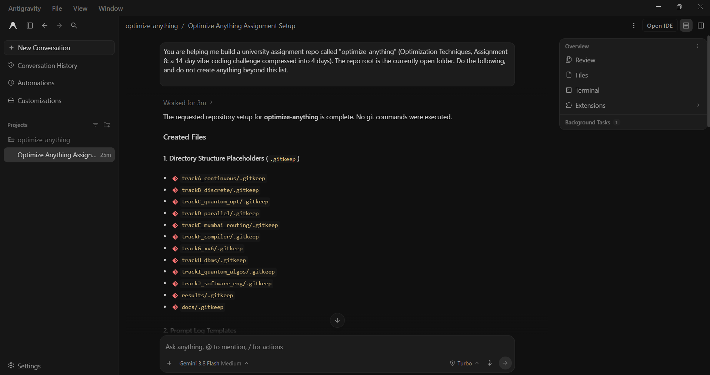

# Prompt log entry
- Date / time: 2026-10-27 21:36:15
- AI tool and model version: Antigravity
- Track: 00_setup

## Original prompt

You are helping me build a university assignment repo called "optimize-anything" (Optimization Techniques, Assignment 8: a 14-day vibe-coding challenge compressed into 4 days). The repo root is the currently open folder. Do the following, and do not create anything beyond this list.

1. Create this folder structure (add a .gitkeep file in each empty folder):
   trackA_continuous/, trackB_discrete/, trackC_quantum_opt/, trackD_parallel/,
   trackE_mumbai_routing/, trackF_compiler/, trackG_xv6/, trackH_dbms/,
   trackI_quantum_algos/, trackJ_software_eng/, tools/, results/, docs/
   and prompts/ with one sub-folder per track: A, B, C, D, E, F, G, H, I, J, plus 00_setup.

2. In every prompts/<track>/ folder, create a TEMPLATE.md with these headings:
   # Prompt log entry
   - Date / time:
   - AI tool and model version:
   - Track:
   ## Original prompt
   ## AI response (relevant excerpt)
   ## Revised prompt (if any)
   ## Resulting code change (commit hash or link)
   ## Verification note (what I ran, what I checked independently)
   ## Chat export / screenshot (filename in this folder)

3. Create tools/new_log.py: a small Python 3 script (standard library only) that takes
   --track (A-J or 00_setup) and --tool, then copies the template into prompts/<track>/ as
   a new file named NNN_YYYY-MM-DD_<tool>.md (NNN auto-increments per track), pre-fills
   date/time, tool and track, and prints the file path. Include input validation and a usage docstring.

4. Create README.md (replace the existing one) with: project title "Optimize Anything",
   a one-paragraph description, a placeholder "Setup & how to run" section, a Commit convention
   section (prefix [AI:<tool>] for AI-generated commits, [MANUAL] for my own edits),
   and an "AI Tools Register" markdown table with columns:
   Tool | Model/version | Tracks | Dates | Kind of work (planning/code generation/debugging/testing/documentation).
   Pre-fill rows for: Claude (planning, review, debugging, documentation) and Antigravity (code generation).
   Leave the model version cells as "TODO".

5. Create these placeholder files with sensible headings only (no invented content):
   - CHECKLIST.md: a table with columns Chapter 6 topic | Method | Experiment | Code location | Result | Status
   - REPORT.md: sections for Tracks A-J and the 10 final questions from the assignment, each marked TODO
   - failure_log.md: table with columns # | Track | What the AI got wrong | How I found it | Fix | Lesson
   - tool_comparison.md: headings for Task, Tools compared, Correctness, Hallucinations, Speed, Prompt iterations, Verdict
   - requirements.txt: empty for now with a comment line

6. Create prompts/00_setup/001_<today's date>_antigravity.md by filling the template with
   THIS prompt as the original prompt. Leave the other sections for me to complete.

When finished, list every file you created. Do not run git commands; I will commit myself.

## AI response (relevant excerpt)

Antigravity created the track folders (with .gitkeep), prompts/ sub-folders with TEMPLATE.md files, tools/new_log.py, README.md, CHECKLIST.md, REPORT.md, failure_log.md, tool_comparison.md and requirements.txt, and listed the files it created.
The requested repository setup for optimize-anything is complete. No git commands were executed.

Created Files
1. Directory Structure Placeholders (.gitkeep)
trackA_continuous/.gitkeep
trackB_discrete/.gitkeep
trackC_quantum_opt/.gitkeep
trackD_parallel/.gitkeep
trackE_mumbai_routing/.gitkeep
trackF_compiler/.gitkeep
trackG_xv6/.gitkeep
trackH_dbms/.gitkeep
trackI_quantum_algos/.gitkeep
trackJ_software_eng/.gitkeep
results/.gitkeep
docs/.gitkeep
2. Prompt Log Templates
prompts/00_setup/TEMPLATE.md
prompts/A/TEMPLATE.md
prompts/B/TEMPLATE.md
prompts/C/TEMPLATE.md
prompts/D/TEMPLATE.md
prompts/E/TEMPLATE.md
prompts/F/TEMPLATE.md
prompts/G/TEMPLATE.md
prompts/H/TEMPLATE.md
prompts/I/TEMPLATE.md
prompts/J/TEMPLATE.md
3. Log Generation Tool
tools/new_log.py
4. Project Documentation & Placeholder Files
README.md
CHECKLIST.md
REPORT.md
failure_log.md
tool_comparison.md
requirements.txt
5. Initial Prompt Log Entry
prompts/00_setup/001_2026-10-27_antigravity.md

## Revised prompt (if any)

None. The first prompt was accepted without changes.

## Resulting code change (commit hash or link)

e0857a8 ([AI:antigravity] chore: scaffold repo structure and logging templates)

## Verification note (what I ran, what I checked independently)

Checked that the folder structure matches the assignment's track layout. Ran tools/new_log.py to confirm it generates a numbered log file in the correct prompts/ sub-folder. Ran `wsl --status`: default version is 2, so WSL is ready for the xv6 and compiler tracks. No errors or AI mistakes found at this stage.

## Chat export / screenshot (filename in this folder)

screenshot_001.png
