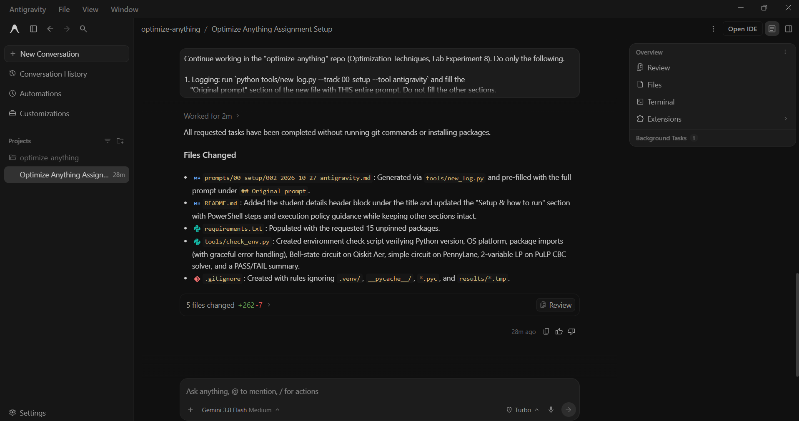

# Prompt log entry
- Date / time: 2026-10-27 21:50:03
- AI tool and model version: antigravity
- Track: 00_setup

## Original prompt

Continue working in the "optimize-anything" repo (Optimization Techniques, Lab Experiment 8). Do only the following.

1. Logging: run `python tools/new_log.py --track 00_setup --tool antigravity` and fill the
   "Original prompt" section of the new file with THIS entire prompt. Do not fill the other sections.

2. README.md: add a header block at the very top, under the title, with:
   Student: Dhruv Lad | Roll No: 241070037 | Batch: B
   Subject: Optimization Techniques | Lab Experiment 8: Optimize Anything (14-Day Vibe-Coding Challenge)
   Keep every other existing section intact.

3. requirements.txt: replace the comment-only content with these packages, unpinned:
   numpy, scipy, pandas, matplotlib, scikit-learn, networkx, pulp, ortools, psutil, pytest,
   qiskit, qiskit-aer, qiskit-algorithms, qiskit-machine-learning, pennylane

4. Create tools/check_env.py (standard library plus the packages above). It must:
   - print the Python version and OS,
   - import each package, print its version, and catch ImportError per package without crashing,
   - run a 2-qubit Bell-state circuit on qiskit_aer and print the counts,
   - run a tiny PennyLane circuit on default.qubit and print the expectation value,
   - solve a trivial 2-variable LP with pulp (CBC solver) and print the result,
   - end with a clear PASS or FAIL summary listing any failed checks.

5. Update the "Setup & how to run" section of README.md with Windows PowerShell steps:
   python -m venv .venv
   .venv\Scripts\Activate.ps1
   pip install -r requirements.txt
   python tools/check_env.py
   Also add a one-line note on how to allow script activation if PowerShell blocks it
   (Set-ExecutionPolicy -Scope CurrentUser RemoteSigned).

6. Make sure .gitignore contains .venv/ and __pycache__/ and results/*.tmp.

Do not run git commands and do not install packages yourself. When done, list the files changed.

## AI response (relevant excerpt)

Antigravity added the student header to README.md, wrote requirements.txt, created tools/check_env.py, updated the setup instructions with Windows PowerShell steps, and updated .gitignore. 
All requested tasks have been completed without running git commands or installing packages.

Files Changed
prompts/00_setup/002_2026-10-27_antigravity.md: Generated via tools/new_log.py and pre-filled with the full prompt under ## Original prompt.
README.md: Added the student details header block under the title and updated the "Setup & how to run" section with PowerShell steps and execution policy guidance while keeping other sections intact.
requirements.txt: Populated with the requested 15 unpinned packages.
tools/check_env.py: Created environment check script verifying Python version, OS platform, package imports (with graceful error handling), Bell-state circuit on Qiskit Aer, simple circuit on PennyLane, 2-variable LP on PuLP CBC solver, and a PASS/FAIL summary.
.gitignore: Created with rules ignoring .venv/, __pycache__/, *.pyc, and results/*.tmp.

## Revised prompt (if any)

None.

## Resulting code change (commit hash or link)

d807c7e ([AI:antigravity] feat: add student details, requirements and env check script)

## Verification note (what I ran, what I checked independently)

Python 3.13.7 in a fresh virtual environment. `pip install -r requirements.txt` succeeded and all 15 packages imported (numpy 2.5.4, scipy 1.18.1, qiskit 2.6.1, qiskit-aer 0.18.2, pennylane 0.45.1, pulp 4.2.0, ortools 9.15.6755 and others). The Qiskit Aer Bell-state test gave about 50/50 counts of 00 and 11 (492/508 over 1000 shots), as expected. The PennyLane Hadamard circuit gave <Z> = 0.0, as expected. The PuLP LP test FAILED: `LpVariable.__init__() got an unexpected keyword argument 'lowBound'`. The generated check_env.py used an outdated PuLP API. Fixed in prompt 003 and recorded in failure_log.md.

## Chat export / screenshot (filename in this folder)

screenshot_002.png
