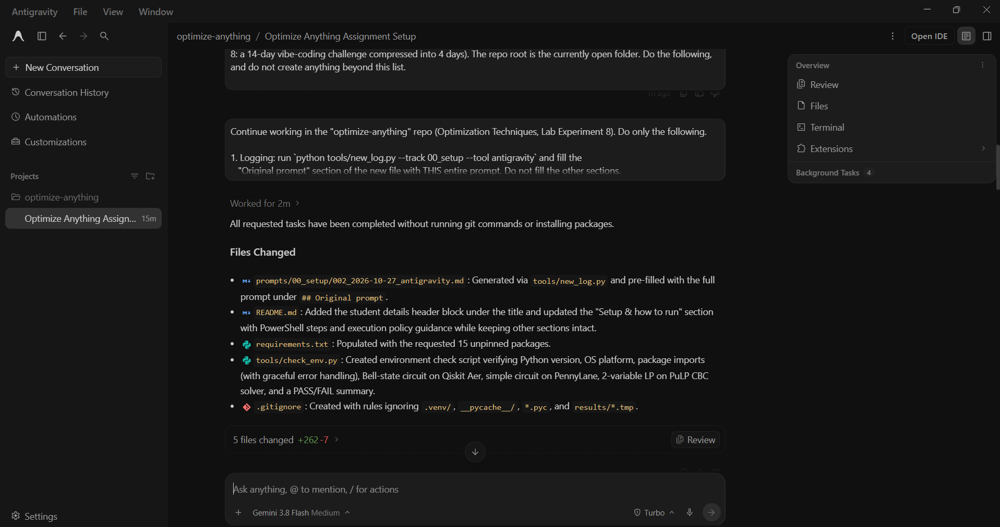

# Prompt log entry
- Date / time: 2026-10-27 22:23:59
- AI tool and model version: antigravity
- Track: 00_setup

## Original prompt

Continue in the "optimize-anything" repo. Do only the following.

1. Logging: run `python tools/new_log.py --track 00_setup --tool antigravity` and fill the
   "Original prompt" section of the new file with THIS entire prompt. Do not fill other sections.

2. Bug: running `python tools/check_env.py` with pulp 4.2.0 fails with:
   "LpVariable.__init__() got an unexpected keyword argument 'lowBound'".
   Do NOT guess the fix. First inspect the installed API, for example by running:
   python -c "import pulp, inspect; print(pulp.__version__); print(inspect.signature(pulp.LpVariable.__init__)); print(inspect.signature(pulp.LpProblem.solve))"
   and check how solvers are selected in this version (for example whether PULP_CBC_CMD still exists).
   Then fix ONLY the PuLP functional test in tools/check_env.py to use the correct argument names
   for the installed version. Keep the same test (a trivial 2-variable LP solved with CBC).

3. Print the signature output you found and explain in 2-3 sentences what had changed.

4. Add a comment above the PuLP test stating the pulp version the code was verified against.

Do not run git commands, do not change anything else, and do not install packages.
After the fix, run `python tools/check_env.py` and show me the full output.

## AI response (relevant excerpt)

Antigravity inspected the installed PuLP 4.2.0 API. It reported that `LpVariable.__init__` now takes only a `_rustcore.Variable` (no `lowBound` argument). It rewrote the PuLP test to use `prob.add_variable(...)` and `pulp.COIN_CMD`, and added a version comment above the test.

## Revised prompt (if any)

None for this entry. The failure after this change led to prompt 004.

## Resulting code change (commit hash or link)

Not committed. The change was superseded by prompt 004 (PuLP removed).

## Verification note (what I ran, what I checked independently)

Re-ran `python tools/check_env.py` on Python 3.13.7. The original `lowBound` error was gone, but the PuLP test now failed with `Pulp: cannot execute cbc.exe`, meaning no CBC solver binary is available. All 15 package imports, the Qiskit Aer Bell-state test (490/510) and the PennyLane test passed. I did not verify Antigravity's explanation of the new PuLP API (`add_variable`, `COIN_CMD`, `cbcbox`) against PuLP's documentation, and the failing result shows that the fix was incomplete. Decision: drop PuLP and use OR-Tools and scipy.optimize.milp instead.

## Chat export / screenshot (filename in this folder)

screenshot_003.png
