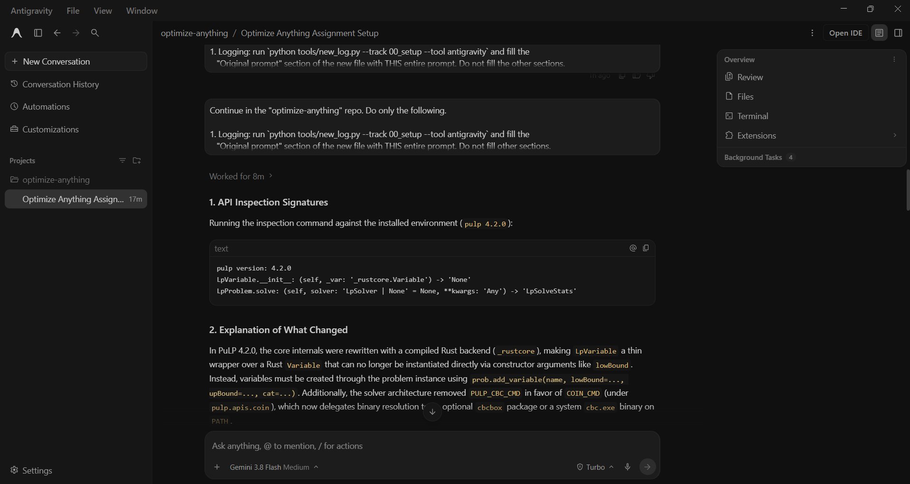

# Prompt log entry
- Date / time: 2026-10-27 22:40:51
- AI tool and model version: antigravity
- Track: 00_setup

## Original prompt

Continue in the "optimize-anything" repo. Do only the following.

1. Logging: run `python tools/new_log.py --track 00_setup --tool antigravity` and fill the
   "Original prompt" section of the new file with THIS entire prompt. Do not fill other sections.

2. Context: the PuLP check in tools/check_env.py fails on pulp 4.2.0 with
   "cannot execute cbc.exe" (no CBC binary available). I am dropping PuLP.
   Remove pulp from requirements.txt and from the package import checks in tools/check_env.py.
   Replace the PuLP functional test with TWO tests of this small integer program:
       maximize 3x + 2y   subject to  x + y <= 4,  x + 3y <= 6,  x, y integers >= 0
   (the expected optimum is objective 12 at x=4, y=0).
   a) OR-Tools: solve it with ortools.linear_solver.pywraplp using the SCIP backend.
   b) SciPy: solve it with scipy.optimize.milp (HiGHS).
   Each test must assert the objective equals 12 and print the objective and variable values.
   Do not guess API names: if a call fails, inspect the installed version with inspect or help() first,
   and print the versions of ortools and scipy that the code was verified against in a comment.

3. If README.md or any other file mentions pulp, remove or update the mention.
   Do not touch anything else.

4. Run `python tools/check_env.py` and show me the full output.

Do not run git commands and do not install packages.

## AI response (relevant excerpt)

Antigravity removed pulp from requirements.txt and from the package import checks in tools/check_env.py. It replaced the PuLP test with two tests of the same integer program (maximize 3x + 2y subject to x + y <= 4 and x + 3y <= 6, integers >= 0): one using OR-Tools (pywraplp, SCIP backend) and one using scipy.optimize.milp (HiGHS). It then ran check_env.py and showed the output.

## Revised prompt (if any)

None.

## Resulting code change (commit hash or link)

11a23f9 ([AI:antigravity] fix: replace PuLP check with OR-Tools and SciPy MILP)

## Verification note (what I ran, what I checked independently)

Ran `python tools/check_env.py` myself on Python 3.13.7. Result: PASS. All 14 remaining packages import (ortools 9.15.6755, scipy 1.18.1, qiskit 2.6.1, qiskit-aer 0.18.2, pennylane 0.45.1 and others). Qiskit Aer Bell-state counts were 502/498 for 00/11. PennyLane <Z> = 0.0. OR-Tools (SCIP) and SciPy milp (HiGHS) both returned x = 4, y = 0, objective = 12, which matches the expected optimum, so the two solvers agree independently. The PuLP dependency was dropped because of the failures documented in failure_log.md entries 1 and 2.

## Chat export / screenshot (filename in this folder)

screenshot_004.png
