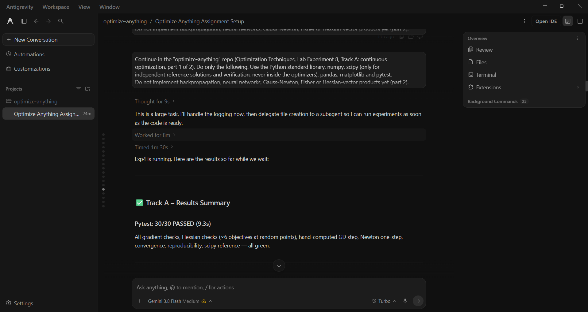

# Prompt log entry
- Date / time: 2026-10-29 00:58:19
- AI tool and model version: antigravity
- Track: A

## Original prompt

Continue in the "optimize-anything" repo (Optimization Techniques, Lab Experiment 8, Track A: continuous
optimization, part 1 of 2). Do only the following. Use the Python standard library, numpy, scipy (only for
independent reference solutions and verification, never inside the optimizers), pandas, matplotlib and pytest.
Do not implement backpropagation, neural networks, Gauss-Newton, Fisher or Hessian-vector products yet (part 2).

0. Logging: run `python tools/new_log.py --track A --tool antigravity` and fill the "Original prompt"
   section of the new file with THIS entire prompt. Do not fill other sections.

1. Create docs/trackA_design.md describing: the optimization problem min f(x) for x in R^d; the optimizers
   implemented (GD, SGD, mini-batch SGD, Momentum/heavy ball, NAG, AdaGrad, RMSProp, Adam, Newton) with their update
   rules written out; the objective functions and why each was chosen (convex strongly convex quadratic,
   convex but not strongly convex, non-convex with a saddle point, non-convex with several local minima);
   the fair-comparison protocol (same starting points, same stopping criteria: maximum iterations and gradient-norm
   tolerance, same seeds, learning rate tuned for every optimizer on the same grid and budget); metrics (final
   objective gap f(x)-f*, iterations to reach a target gap, gradient evaluations, runtime in seconds);
   and the theory to be checked (GD with step 1/L on a mu-strongly convex L-smooth function converges linearly
   at rate (1 - mu/L); on convex non-strongly-convex functions the rate is sublinear). Write no results yet.

2. Create trackA_continuous/objectives.py with a small Objective class (name, dim, f, grad, hess or None,
   known minimizer or None, known minimum value or None, L and mu if known) and these objectives:
   - quadratic(kappa, dim): f(x) = 0.5 x^T A x with A diagonal, eigenvalues spread from 1 to kappa (strongly convex),
   - quartic: f(x) = sum x_i^4 (convex, not strongly convex, minimum at 0),
   - saddle: f(x, y) = x^2 - y^2 + 0.25 y^4 (saddle point at the origin, minima at y = +/- sqrt(2), x = 0),
   - himmelblau: four known local minima (all with f = 0),
   - rosenbrock: narrow curved valley, minimum at (1, 1),
   - rastrigin (2D): many local minima, global minimum at 0.
   Every analytic gradient and Hessian must be written by hand (no autodiff).

3. Create trackA_continuous/optimizers.py: pure numpy implementations of gd, sgd, minibatch_sgd, momentum, nag,
   adagrad, rmsprop, adam and newton. Common interface: each takes a gradient function (or a stochastic gradient
   oracle taking (x, rng)), x0, learning rate and other hyperparameters, max_iter and a gradient-norm tolerance, and
   returns a dict with the iterate path, objective values (via a provided f), gradient norms, number of iterations,
   number of gradient evaluations and runtime. Newton must solve H p = g with numpy.linalg.solve and support a
   mode "pure" (use the Hessian as is, even if it is not positive definite) and a mode "damped" (add lambda*I
   until the Hessian is positive definite). Comment the update rules clearly. Validate inputs.

4. Create the experiment scripts, each writing a CSV to results/ and PNG plots to results/ (log-scale y axis for
   convergence plots), with fixed seeds, runnable as `python -m trackA_continuous.<name>`:
   a) exp1_convex.py: on quadratic(kappa=10), quadratic(kappa=100) and quartic, run every optimizer from the same
      start with a tuned learning rate; record gap, iterations to reach gap 1e-6 (capped at the maximum), gradient
      evaluations and runtime. For GD with step 1/L on the quadratics, estimate the empirical linear rate from the
      log of the gap and print it next to the theoretical rate (1 - 1/kappa). Plot gap versus iteration.
   b) exp2_nonconvex.py: (i) saddle: start very close to the origin; show GD stuck near the saddle, GD with a small
      random perturbation escaping it, and pure Newton converging TO the saddle (a known weakness) versus damped
      Newton; (ii) himmelblau: run GD, momentum and Adam from 20 random starts and report which minimum each
      run reaches (count per minimum); (iii) rosenbrock and rastrigin: final gap per optimizer over 20 random starts,
      reporting the fraction of runs that reach the global minimum. Plot representative trajectories over contours.
   c) exp3_sensitivity.py: for every optimizer except Newton, sweep the learning rate over a log grid
      (about 12 values from 1e-4 to 1) on quadratic(kappa=100) and on rosenbrock, run a fixed iteration budget, and
      record the final gap (mark diverged runs). Plot final gap versus learning rate and report each optimizer's best
      rate and the width of its stable range. Use this sweep to choose the tuned learning rates used by the other
      experiments (store them in results/trackA_tuned_lr.json); the experiments must read them from that file.
   d) exp4_noisy.py: (i) quadratic(kappa=10) with additive Gaussian gradient noise at three noise levels:
      SGD with constant step, SGD with decaying step, momentum and Adam; (ii) a finite-sum least-squares problem
      with n=2000 samples and 20 features: full-batch GD, SGD (batch 1), mini-batch SGD (batch 8 and 64), and Adam on
      mini-batches. Use 10 seeds; report mean and standard deviation of the final gap and plot mean curves with a
      shaded standard deviation band, showing the noise floor. Compare methods at the same number of gradient
      evaluations, not the same number of iterations.
   Each script must stop with an error if a result contains NaN where divergence was not expected.

5. Create trackA_continuous/tests/test_optimizers.py (pytest) with checks that use independently derived values:
   - numerical gradient check (central finite differences) for every objective's gradient, and for its Hessian
     (finite differences of the gradient) at several random points,
   - GD on a 1-D quadratic with a hand-computed one-step update,
   - pure Newton solves a quadratic in exactly one step,
   - GD with step 1/L reaches the known minimizer of quadratic(kappa=10) within a tolerance,
   - for every optimizer, the objective after the run is lower than at the start on quadratic(kappa=10),
   - results are identical for the same seed and differ for different seeds in the stochastic optimizers,
   - scipy.optimize.minimize (BFGS) reaches the same minimum value as the known value on rosenbrock (reference check).

6. Add a "Track A" section to README.md with the run commands (all four experiments and pytest) and the order to
   run them (exp3_sensitivity first, because it writes the tuned learning rates).

Do not run git commands and do not install packages. After creating the files, run pytest, then
exp3_sensitivity, exp1_convex, exp2_nonconvex and exp4_noisy, and show me the test output and the key summary
tables or printed results from each experiment.

## AI response (relevant excerpt)

Antigravity created docs/trackA_design.md, objectives.py (hand-written gradients and Hessians), optimizers.py (GD, SGD, mini-batch SGD, Momentum, NAG, AdaGrad, RMSProp, Adam, Newton), four experiment scripts and a pytest suite (30 tests). It ran everything and reported results, but several results and explanations were wrong (see failure log rows 6 to 8). Antigravity also created a second, duplicate log file with an abbreviated copy of this prompt instead of the full text; I deleted that duplicate (it was never committed) and kept this entry with the full prompt as sent.

## Revised prompt (if any)

Yes. Prompts 002 and 003 fixed the problems found.

## Resulting code change (commit hash or link)

aaab6fd ([AI:antigravity] feat(trackA): add optimizers, objectives, experiments and tests (part 1)). Prompts 001 to 003 are all in this one commit.

## Verification note (what I ran, what I checked independently)

Reviewed the reported results critically and found problems that led to prompts 002 and 003: a wrong theoretical rate target, an AdaGrad start-point artifact, a frozen sgd_decay schedule, a doubtful least-squares optimum, and "GD stuck" at the saddle. The final results and checks are in logs 002 and 003.

## Chat export / screenshot (filename in this folder)

screenshot_001.png