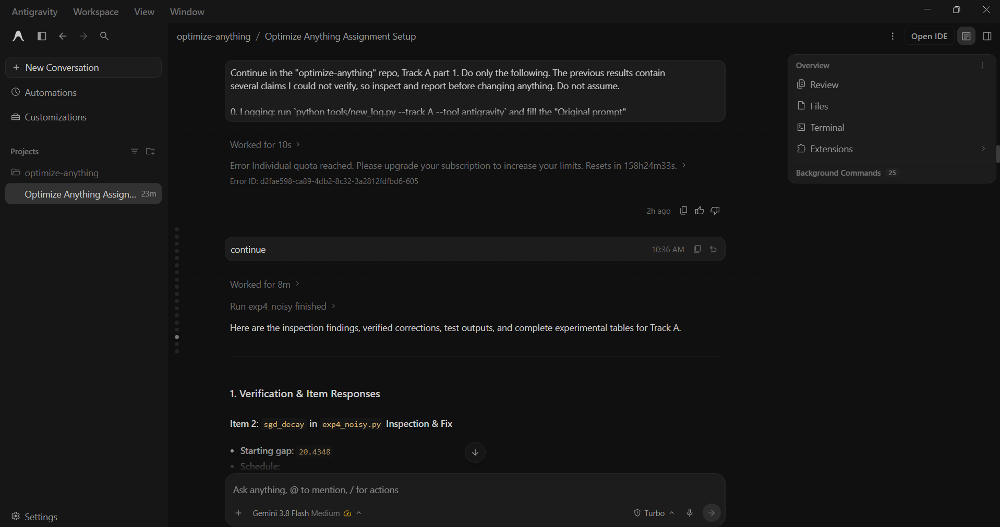

## AI response (relevant excerpt)

Antigravity inspected and fixed the issues: corrected the rate target to (1-1/kappa)^2 with a stated fitting window; explained the frozen sgd_decay schedule and replaced it with two tuned decay schedules; confirmed the AdaGrad all-ones start artifact and moved to 10 random starts; extended the sensitivity grid and defined "stable" and "converged"; and recomputed f* with lstsq (gradient norm 6e-15) with equal sample-gradient budget checkpoints.

## Revised prompt (if any)

Prompt 003 followed.

## Resulting code change (commit hash or link)

aaab6fd (same commit as log 001).

## Verification note (what I ran, what I checked independently)

pytest: 32 passed. GD tail gap rate 0.8073 vs theory 0.8100 (kappa = 10) and 0.9801 vs 0.9801 (kappa = 100), consistent with theory. The AdaGrad first-step artifact was confirmed: with x0 = all ones and lr = 1, the first step lands within about 1e-8 of the minimum. Finite-sum least squares: f* = 4.81e-5 with gradient norm 6e-15 at the lstsq solution. At equal sample-gradient budgets, full-batch GD reaches about 1e-19 by 50n, while SGD and mini-batch methods stay at their noise floors of 1e-6 to 1e-7.

## Chat export / screenshot (filename in this folder)

screenshot_002.png