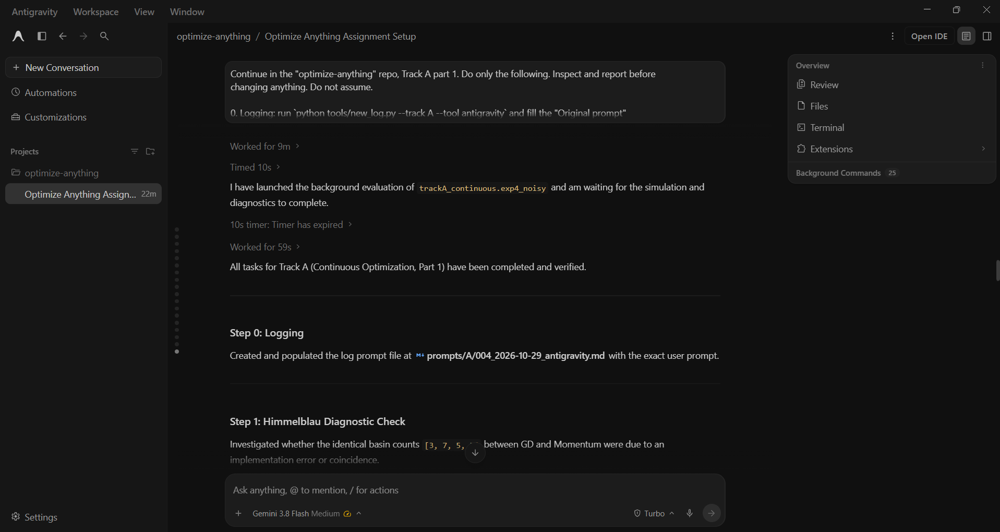

## AI response (relevant excerpt)

Antigravity printed per-start Himmelblau diagnostics (GD, Momentum and Adam basins, learning rates, and a maximum GD-versus-Momentum path distance of 0.56 to 2.48 over the first 50 steps), replaced the "GD stuck" claim with a saddle-escape table, re-tuned the learning rates over 5 random starts per problem (median and IQR), and corrected the documentation wording.

## Revised prompt (if any)

None. I accepted the remaining weaknesses as report limitations to save time.

## Resulting code change (commit hash or link)

aaab6fd (same commit as log 001).

## Verification note (what I ran, what I checked independently)

pytest: 34 passed (I re-ran it myself). Momentum uses beta = 0.9 and its paths differ from GD's, so the identical Himmelblau basin counts are a coincidence of start points lying deep inside basins. Saddle escape iterations for GD: 31, 56, 104 and 152 for y0 = 1e-1, 1e-2, 1e-4 and 1e-6, growing roughly with log(1/y0); pure Newton stayed at the saddle and damped Newton escaped in 6 iterations. Known limitations: on Rosenbrock the learning-rate sweep ranks progress within 2000 iterations, not convergence (all methods have a median gap of about 4, 0 of 5 converged); the learning-rate grid is 1e-4 to 10, not the 1e-5 to 100 requested; Adam's noisy-quadratic numbers changed between runs without a verified cause; pure Newton in the saddle table started at x0 = 1.0 while the others started at 0.

## Chat export / screenshot (filename in this folder)

screenshot_003.png