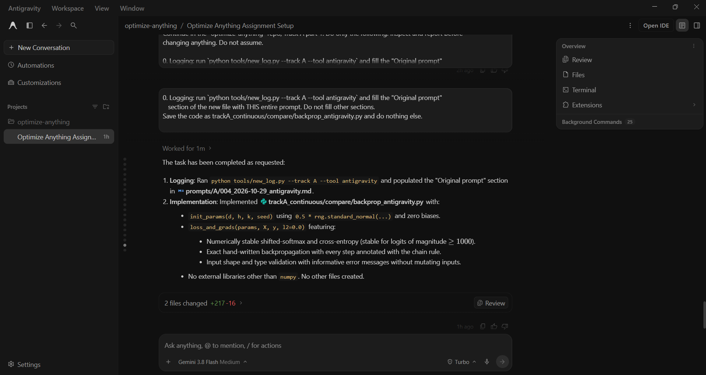

# Prompt log entry
- Date / time: 2026-10-29 12:29:48
- AI tool and model version: antigravity
- Track: A

## Original prompt
0. Logging: run `python tools/new_log.py --track A --tool antigravity` and fill the "Original prompt"
   section of the new file with THIS entire prompt. Do not fill other sections.
Save the code as trackA_continuous/compare/backprop_antigravity.py and do nothing else.

Write one Python file using only numpy. It must define:

1. init_params(d, h, k, seed) -> dict with keys W1 (d,h), b1 (h,), W2 (h,k), b2 (k,). Weights are
   0.5 * standard normal from numpy.random.default_rng(seed); biases are zeros.

2. loss_and_grads(params, X, y, l2=0.0) -> (loss, grads) for a 2-layer network:
   hidden = tanh(X @ W1 + b1); logits = hidden @ W2 + b2;
   loss = mean softmax cross-entropy over the n samples (y holds integer class labels 0..k-1)
          + 0.5 * l2 * (sum(W1**2) + sum(W2**2)).
   grads is a dict with the same keys and shapes as params, computed by hand-written backpropagation
   (no autodiff libraries and no finite differences).

Requirements: numerically stable softmax (loss and grads must stay finite even for logits of magnitude
1000); do not modify the inputs; validate input shapes with clear error messages; comment each
backprop step with the chain rule. Do not write tests or any other files.

## AI response (relevant excerpt)

Antigravity created trackA_continuous/compare/backprop_antigravity.py with init_params and loss_and_grads (two-layer tanh network, softmax cross-entropy, L2 regularization, hand-written backpropagation, numpy only). This is the Antigravity side of the two-tool comparison; the same task text was given to Claude in a fresh chat (see log 005).

## Revised prompt (if any)

None. No follow-up prompts were needed.

## Resulting code change (commit hash or link)

52d2c02 ([AI:antigravity] feat(trackA): add backprop implementation for tool comparison). The shared test file is commit 58b4a48 ([AI:claude] test(trackA): add tool-independent backprop comparison tests).

## Verification note (what I ran, what I checked independently)

Ran `pytest trackA_continuous/compare -v` before changing anything. The 9 Antigravity tests passed on the first attempt (finite-difference gradient checks with and without L2, loss vs an independent reference, shapes and keys, numerical stability at logits of magnitude 1000, input immutability, deterministic init, gradient descent on XOR). The test file was written before either tool produced code and was not edited afterwards. I did not edit the generated code. Full comparison and its limitations are in tool_comparison.md.

## Chat export / screenshot (filename in this folder)

screenshot_004.png
