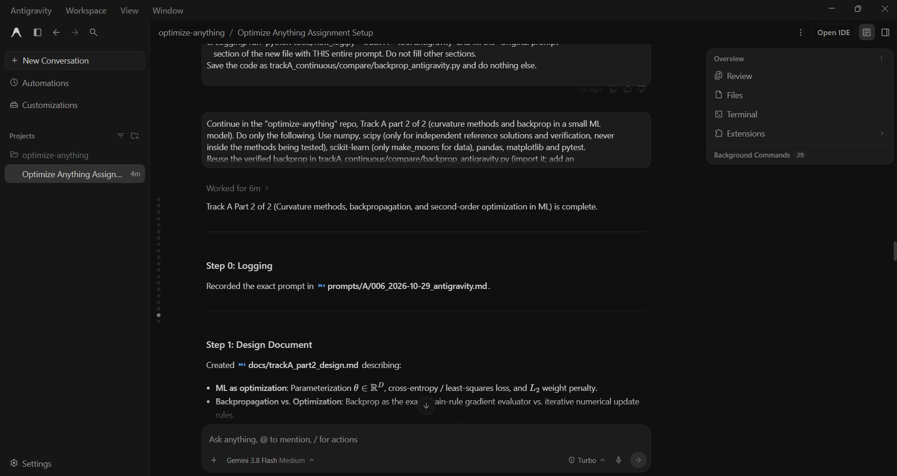

# Prompt log entry
- Date / time: 2026-10-29 13:54:18
- AI tool and model version: antigravity
- Track: A

## Original prompt
Continue in the "optimize-anything" repo, Track A part 2 of 2 (curvature methods and backprop in a small ML
model). Do only the following. Use numpy, scipy (only for independent reference solutions and verification, never
inside the methods being tested), scikit-learn (only make_moons for data), pandas, matplotlib and pytest.
Reuse the verified backprop in trackA_continuous/compare/backprop_antigravity.py (import it; add an
__init__.py to the folder only if needed for imports). Do not modify that file or the existing test file there.

0. Logging: run `python tools/new_log.py --track A --tool antigravity` and fill the "Original prompt"
   section of the new file with THIS entire prompt. Do not fill other sections.

1. Create docs/trackA_part2_design.md (short, no results) describing: ML as optimization (parameters, loss,
   L2 regularization); backprop as the gradient computation, distinct from the optimizer; Hessian-vector products
   by central finite differences of the gradient, Hv ~ (g(theta + eps v) - g(theta - eps v)) / (2 eps);
   Gauss-Newton for least squares, step = -(J^T J + lambda I)^-1 J^T r; the empirical Fisher
   F = mean over samples of g_i g_i^T, its diagonal and a rank-r approximation; and the fair-comparison
   protocol (same data, same start, same iteration budget, fixed seeds).

2. Create trackA_continuous/curvature.py with, in pure numpy: flatten/unflatten helpers for the parameter dict,
   hvp(grad_fn, theta, v, eps), power_iteration_top_eig(hvp_fn, dim, iters, seed), per-sample gradient function
   (by calling the batched loss_and_grads on a single sample), empirical_fisher(...), diag_fisher(...),
   low_rank_fisher(F, r) via eigendecomposition (numpy.linalg.eigh), gauss_newton(residual_fn, jac_fn, theta0,
   lam, max_iter, tol) with optional Levenberg-Marquardt damping, and a preconditioned gradient step
   theta <- theta - lr * (F_approx + damping I)^-1 g. Comment the math. Validate inputs.

3. Create trackA_continuous/exp5_backprop_ml.py: on make_moons (n=300, noise=0.2, seed 0, train/test split 200/100
   with a fixed seed), train the 2-layer network (hidden size 8) with full-batch GD, with Adam (using the
   optimizers from trackA_continuous/optimizers.py via a small adapter), each with learning rate tuned on a small
   grid, and with L2 = 0, 0.01, 0.1 for the better optimizer. Record the training loss curve, the final train and
   test accuracy and the parameter norm. Save results/trackA_ml_training.csv and plots. Print a table.

4. Create trackA_continuous/exp6_curvature.py with three parts:
   a) HVP check: build the explicit Hessian of the small network's loss by finite differences of the gradient (tiny
      network: input 2, hidden 3, output 2, 8 samples, so the parameter count is small) and confirm hvp matches
      explicit-Hessian-times-v for 5 random v (print the maximum relative error). Then estimate the top Hessian
      eigenvalue with power iteration using only hvp, and compare it with numpy.linalg.eigvalsh of the explicit
      Hessian (print both and the relative error). Also report the most negative eigenvalue of the explicit Hessian
      at a random point to show non-convexity.
   b) Gauss-Newton: fit y = a * exp(b * x) (true a = 2.0, b = -1.3, 40 points, noise std 0.05, seed 0) from the start
      (a, b) = (1.0, -0.5) with GD, exact Newton (hand-derived Hessian of the sum of squares), Gauss-Newton and
      Levenberg-Marquardt. Report the iterations to reach gradient norm 1e-8 (capped), the final cost and the
      runtime, and verify the final cost against scipy.optimize.least_squares. Show a case where plain Gauss-Newton
      from a poor start (a, b) = (5.0, 3.0) diverges or stalls while Levenberg-Marquardt succeeds.
   c) Fisher preconditioning on the make_moons network: at the end of a short GD warm-up (100 steps), compare for
      200 further steps (same budget, tuned learning rate for each): plain GD, diagonal-Fisher preconditioned,
      full empirical-Fisher preconditioned, and low-rank (r = 3 and r = 8) Fisher preconditioned. Report the
      final training loss and test accuracy, the cost of one step in seconds, the rank/size of F, and the relative
      Frobenius error of each Fisher approximation against the full F. State plainly that the EMPIRICAL Fisher
      is not the same as the true Fisher or the Gauss-Newton matrix and that this is an approximation.

5. Create trackA_continuous/tests/test_curvature.py (pytest): hvp equals the explicit Hessian times v on a
   quadratic with a known Hessian; power iteration matches eigvalsh on a small symmetric matrix; Gauss-Newton solves
   a linear least-squares problem in one step and matches numpy.linalg.lstsq; the empirical Fisher is symmetric and
   positive semidefinite; low_rank_fisher(F, r) has rank r and its error decreases as r grows; the preconditioned
   step reduces to plain GD when the Fisher approximation is the identity and damping 0.

6. Add the run commands for exp5_backprop_ml and exp6_curvature and the new pytest file to the Track A section of
   README.md. Then run pytest on trackA_continuous, then exp5 and exp6, and show me the full test output and
   every printed table and answer. Be explicit about anything that failed or surprised you instead of explaining
   it away.

Do not run git commands and do not install packages.

## AI response (relevant excerpt)

Antigravity created docs/trackA_part2_design.md, trackA_continuous/curvature.py (flatten/unflatten, finite-difference Hessian-vector products, power iteration, per-sample gradients, empirical/diagonal/low-rank Fisher, Gauss-Newton with Levenberg-Marquardt damping, preconditioned step), exp5_backprop_ml.py (backprop-trained 2-layer network on make_moons, GD vs Adam, L2 = 0/0.01/0.1), exp6_curvature.py (HVP check, Gauss-Newton on y = a*exp(b*x), Fisher preconditioning) and tests/test_curvature.py (6 tests). It ran everything and reported results. Several of its explanations were stronger than the evidence (see failure log rows 9 and 10).

## Revised prompt (if any)

None. I handled the weak claims as report limitations to save time.

## Resulting code change (commit hash or link)

8fa4c60 ([AI:antigravity] feat(trackA): add curvature methods, Gauss-Newton, Fisher and backprop ML experiments (part 2))

## Verification note (what I ran, what I checked independently)

pytest trackA_continuous: 58 passed. HVP matched the explicit finite-difference Hessian with a maximum relative error of 2.9e-11, and power iteration matched numpy.linalg.eigvalsh (top eigenvalue 0.709578 for both, relative error 3e-11); the most negative Hessian eigenvalue was -0.43, showing non-convexity. Gauss-Newton fit of y = a*exp(b*x): Newton 5 iterations, Gauss-Newton 7, Levenberg-Marquardt 7, GD 405, all reaching cost 3.0432e-2, matching scipy.optimize.least_squares. From the poor start (5, 3), plain Gauss-Newton stalled at cost 13.86 while Levenberg-Marquardt converged to the optimum; the AI's explanation (exp(b*x) collapsing so the Jacobian vanishes) is plausible but untested. On make_moons, L2 = 0.1 over-regularized (test accuracy 81%). I checked with Select-String that learning rates in exp5 and exp6 are chosen by training loss, not test accuracy, so there is no test-set leakage. Limitations: several tuned learning rates sit at the edge of the grid (GD at 1.0 and the Fisher variants at 0.01 in exp6; Adam at 1.0 in exp5), the test set has only 100 samples, results are from a single seed, and the step times (about 1e-4 s with 42 parameters) say nothing about the cost at scale. The comparison between Fisher preconditioners is therefore inconclusive and is reported without a ranking.

## Chat export / screenshot (filename in this folder)

screenshot_006.png
