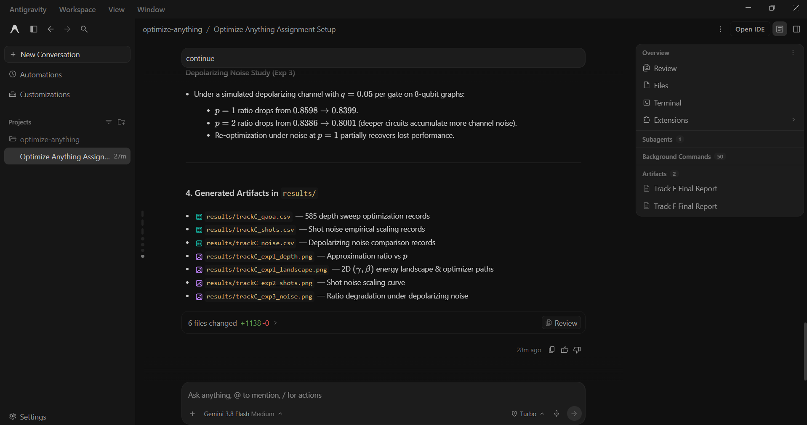

# Prompt log entry
- Date / time: 2026-10-30 12:16:07
- AI tool and model version: antigravity
- Track: C

## Original prompt

Continue in the "optimize-anything" repo, Track C (quantum optimization, part 1 of 2). The Track B Max-Cut instances
are in results/trackB_maxcut_instances.json (15 graphs, n = 10, 12, 14, with the optimal cut value), and
trackB_discrete/qubo.py has the Max-Cut QUBO and the classical baselines. Do only the following. Use numpy, scipy
(scipy.optimize.minimize with COBYLA), pennylane (default.qubit and default.mixed), pandas, matplotlib and pytest.
Do not use qiskit in this prompt. Make trackC_quantum_opt a package (add __init__.py) so that
`python -m trackC_quantum_opt.<name>` works. Read the JSON before using it and do not assume its structure.

0. Logging: run `python tools/new_log.py --track C --tool antigravity` and fill the "Original prompt"
   section of the new file with THIS entire prompt. Do not fill other sections.

1. Create docs/trackC_design.md (short, no results): QAOA for Max-Cut (cost Hamiltonian, mixer, p layers, the
   state, the expected cut <C> as the objective); the parameter-shift rule and the fact that it is exact only for
   gates generated by operators with two eigenvalues, and that when one parameter drives several gates with scale
   factors (gamma times each edge weight) the shift rule must be applied per gate occurrence and summed with the chain
   rule, not once on the shared parameter; SPSA (two evaluations per iteration regardless of the number of
   parameters); finite-shot estimation (the standard deviation of the estimator falls like 1/sqrt(shots));
   depolarizing noise; and the fair-comparison protocol (equal numbers of circuit evaluations, several random starts,
   same instances). State that all results are SIMULATED and that no real quantum hardware is used.

2. Create trackC_quantum_opt/qaoa_sim.py: an independent pure-numpy statevector QAOA simulator.
   - maxcut_diagonal(n, edges, weights): the vector of cut values for all 2^n bitstrings (cut = sum w_ij when the
     endpoints differ). Document the bit-order convention.
   - qaoa_state(gammas, betas, diag, n) using the standard circuit: uniform superposition, then p times a phase
     exp(-i gamma * cut(x)) followed by the mixer exp(-i beta X_j) on every qubit.
   - expected_cut(params, ...), probabilities, sample(params, shots, rng), approximation_ratio, probability_of_optimal.
   - param_shift_grad(params, ...): the parameter-shift gradient applied per gate occurrence (for the phase layer
     use each edge's own angle gamma * w_e, shift it by pi/2 and combine by the chain rule, summed over edges; for
     the mixer shift each qubit's rotation angle and sum), plus finite_diff_grad (central differences). Both must be
     exact for exact expectations.
   Validate inputs and keep it fast (vectorised numpy, no Python loops over the 2^n amplitudes).

3. Create trackC_quantum_opt/optimizers_q.py: spsa(f, x0, iters, a, c, seed) (own implementation with the standard
   gain sequences, two function evaluations per iteration), adam_ps (Adam using a supplied gradient function), and a
   wrapper around scipy COBYLA. All count circuit evaluations (a gradient by parameter shift costs 2 per parameter).

4. Create trackC_quantum_opt/exp1_qaoa.py (`python -m trackC_quantum_opt.exp1_qaoa`):
   a) Validation: (i) for every instance check that max(diagonal) equals the optimal cut in the JSON; (ii) for a
      6-node random graph check that the diagonal equals -(x^T Q x) from trackB_discrete.qubo.maxcut_to_qubo for every
      assignment; (iii) compare expected_cut from the numpy simulator with a PennyLane implementation of the same QAOA
      circuit (default.qubit; build the cost layer from IsingZZ gates and the mixer from RX gates with the angle
      conventions that make them equal) on 3 instances at random parameters, printing the maximum absolute difference
      (must be below 1e-9, otherwise stop with an error); (iv) compare the per-gate parameter-shift gradient with
      central finite differences AND with PennyLane's own gradient on weighted instances (maximum relative error below
      1e-6, otherwise stop with an error). Also show what a naive parameter shift of gamma (one shift on the shared
      parameter) gives on a weighted graph and its error, to demonstrate why it is wrong.
   b) QAOA depth sweep: for p = 1, 2, 3 and every instance, run (1) Adam with parameter-shift gradients, (2) COBYLA
      and (3) SPSA, each from 5 random starts (gamma in [0, pi], beta in [0, pi/2], fixed seeds) with the same budget
      of 300 circuit evaluations per run. Record the expected cut ratio (expected cut over the optimal cut), the
      probability of sampling an optimal assignment, the best cut found by sampling 1000 shots from the final state
      (ratio to the optimum), and the number of circuit evaluations used. Keep the total runtime around 15 minutes; if
      your estimate is higher, reduce the number of starts for n = 14 and say so in the output.
   c) Classical comparison: from trackB_discrete reuse the greedy local search (20 restarts), simulated annealing and
      the exact optimum for the same instances, plus a random assignment baseline (expected cut = half of the total
      weight), and report all of them as ratios of the optimum next to QAOA.
   Save results/trackC_qaoa.csv and print summary tables (mean and standard deviation over instances and starts, per n,
   per p, per optimizer). Plot the ratio against p for each optimizer and the expected-cut landscape of one n = 10
   instance at p = 1 over a (gamma, beta) grid with the optimizer end points marked.

5. Create trackC_quantum_opt/exp2_shots.py (`python -m trackC_quantum_opt.exp2_shots`): on one n = 10 instance at p = 1
   with optimized parameters, estimate the expected cut from shots S = 100, 1000, 10000, 100000, 200 repetitions each;
   report the mean, the standard deviation, the exact value, and fit the log-log slope of the standard deviation
   against S (it should be near -0.5); check the estimator is unbiased (mean within 3 standard errors of the exact
   value). Then compare, for the same n = 10 instance and p = 2, SPSA and Adam with parameter-shift gradients when
   every function evaluation uses 1000 shots (5 starts, same budget of circuit evaluations): report the final TRUE
   (exact) expected cut ratio of the parameters found, and the total number of shots used. Save
   results/trackC_shots.csv and a plot of the standard deviation against S.

6. Create trackC_quantum_opt/exp3_noise.py (`python -m trackC_quantum_opt.exp3_noise`): on 3 random 8-node Max-Cut
   graphs (networkx or numpy, fixed seeds, brute-force optimum), use PennyLane's default.mixed device with a
   depolarizing channel of probability q applied to every qubit after each cost layer and each mixer layer, for
   q in {0, 0.001, 0.01, 0.05} and p in {1, 2, 3}. Use parameters optimized on the noiseless numpy simulator and report
   the expected cut ratio under noise; also re-optimize under noise with COBYLA (300 evaluations, 3 starts) and report
   the ratio. Verify that q = 0 reproduces the numpy simulator within 1e-9. Plot the ratio against q for each p. State
   in the output and in the docstring that this is a noise MODEL on a simulator and not hardware.

7. Create trackC_quantum_opt/tests/test_qaoa.py (pytest): the diagonal of a hand-built triangle graph (cut values
   0, 2, 2, ...) matches by hand; max of the diagonal equals brute force on 5 random graphs; the numpy simulator equals
   PennyLane on a 4-node weighted graph; per-gate parameter shift equals finite differences on weighted graphs and the
   naive shared-parameter shift does NOT (assert its error is large); for the one-qubit circuit RX(theta) with
   observable Z the parameter-shift gradient equals -sin(theta); SPSA is deterministic for a fixed seed and reduces the
   expected-cut objective on a small graph; the shot estimator is unbiased within 4 standard errors over 2000 shots
   and its standard deviation at 10000 shots is smaller than at 100 shots; depolarizing noise with q = 0 reproduces the
   noiseless result and q = 0.05 lowers the expected cut ratio at p = 2.

8. Add the run commands (python -m ...) to a "Track C" section of README.md, using `python -m pytest` for tests.
   Then run `python -m pytest trackC_quantum_opt -q` and the three experiments, and show me the full test output and
   every printed table. State plainly anything that failed, any validation that did not pass, and anything
   surprising. Do not explain anything away without evidence.

Do not run git commands and do not install packages.

## AI response (relevant excerpt)

Antigravity added docs/trackC_design.md, a pure-numpy QAOA statevector simulator (qaoa_sim.py) with a per-gate parameter-shift gradient, SPSA, Adam and COBYLA optimizers (optimizers_q.py), three experiments (QAOA depth sweep on the 15 Track B Max-Cut instances, finite-shot scaling, depolarizing noise with PennyLane default.mixed) and 9 tests. All results are simulated; no quantum hardware was used. Its first summary of the shot-noise experiment was incomplete (failure log row 17).

## Revised prompt (if any)

Yes. A second prompt added the missing optimizer arms (see log 2).

## Resulting code change (commit hash or link)

e7853f7 ([AI:antigravity] feat(trackC): add QAOA simulator, parameter-shift, SPSA, shot and noise experiments (part 1))

## Verification note (what I ran, what I checked independently)

Re-ran `python -m pytest trackC_quantum_opt -q`: 9 passed. The experiment output reports that the numpy simulator agrees with PennyLane default.qubit to about 3e-14, that the maximum of the cut diagonal equals the optimal cut on all instances and agrees with the Track B QUBO encoding, and that the per-gate parameter-shift gradient matches finite differences while a naive single shift of the shared gamma parameter is wrong on weighted graphs (-0.21 against the correct -19.56). Expected-cut ratio for p = 1, 2, 3: n = 10: Adam 0.727/0.788/0.763, COBYLA 0.712/0.790/0.774, SPSA 0.674/0.679/0.666; n = 12: Adam 0.709/0.741/0.757; n = 14: Adam 0.689/0.727/0.739 (random assignment gives 0.64 to 0.66; the standard deviations of 0.02 to 0.09 are as large as most differences between depths). Classical greedy local search and simulated annealing reached the exact optimum (ratio 1.0) on every instance, so shallow QAOA (p <= 3) is clearly worse than classical methods at this size. Finite-shot estimator: log-log slope of the standard deviation against shots -0.494 (theory -0.5) and unbiased within 4 standard errors at 100, 1000, 10000 and 100000 shots. Depolarizing noise (q = 0.05) on three 8-node graphs lowered the ratio from 0.860 to 0.840 (p = 1) and from 0.839 to 0.800 (p = 2). Limitations: all results are simulated, the budget of 300 circuit evaluations is too small for SPSA to converge, the noise study uses only three small graphs and a simple depolarizing model, and the ratios are averages with substantial spread.

## Chat export / screenshot (filename in this folder)

screenshot_001.png
