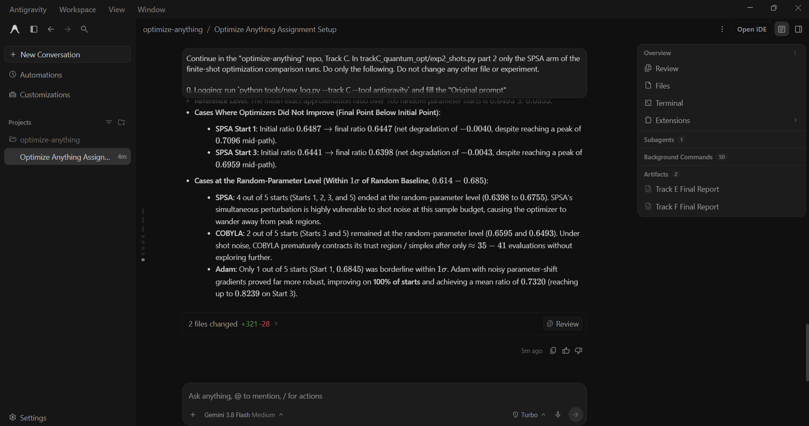

# Prompt log entry
- Date / time: 2026-10-30 15:27:52
- AI tool and model version: antigravity
- Track: C

## Original prompt

Continue in the "optimize-anything" repo, Track C. In trackC_quantum_opt/exp2_shots.py part 2 only the SPSA arm of the
finite-shot optimization comparison runs. Do only the following. Do not change any other file or experiment.

0. Logging: run `python tools/new_log.py --track C --tool antigravity` and fill the "Original prompt"
   section of the new file with THIS entire prompt. Do not fill other sections.

1. In exp2_shots.py part 2 add the missing arm: Adam with parameter-shift gradients, where every circuit evaluation
   used by the gradient is a 1000-shot estimate (so the gradient is noisy), same instance (n = 10, p = 2), the same 5
   starts, and the same total budget of 300 circuit evaluations per run as the SPSA runs. Also add a COBYLA arm with
   1000-shot evaluations and the same budget. For all three optimizers report, per start and as a mean, the final
   TRUE (exact, noiseless) expected-cut ratio of the parameters found, the number of circuit evaluations used, and the
   total number of shots used (evaluations times 1000). Keep the existing SPSA rows.

2. Add a second small table: the best exact ratio over the whole optimization path (not only the final point) for each
   optimizer, so that the final-point noise is not mistaken for no progress. Also print the exact ratio of random
   parameters (mean over 100 random starts) as the reference level.

3. Append the new results to results/trackC_shots.csv (new columns allowed, keep the existing statistics rows
   readable, or write a second file results/trackC_shots_opt.csv, your choice, and say which).

4. Re-run `python -m trackC_quantum_opt.exp2_shots` and show me the full printed output. State plainly any result
   that is at the random-parameter level and any case where an optimizer did not improve.

Do not run git commands and do not install packages.

## AI response (relevant excerpt)

Antigravity added the missing arms to exp2_shots.py part 2: Adam with parameter-shift gradients and COBYLA, both with 1000-shot evaluations on the n = 10 instance at p = 2 from the same 5 starts as SPSA, plus a table of the best exact ratio along each optimization path and a random-parameter reference (100 random starts). Results are saved in results/trackC_shots_opt.csv.

## Revised prompt (if any)

None.
 
## Resulting code change (commit hash or link)

e7853f7 (same commit as log 1).

## Verification note (what I ran, what I checked independently)

Read the printed output of `python -m trackC_quantum_opt.exp2_shots`. Final exact expected-cut ratio of the parameters found (mean of 5 starts, 1000-shot evaluations, budget of 300 circuit evaluations): Adam with parameter-shift 0.732 (every start improved, best 0.824), COBYLA 0.686, SPSA 0.665; random parameters 0.649 +/- 0.035; initial ratio 0.658. SPSA reached 0.731 at its best point on the path but ended lower, and 2 of 5 starts ended below their initial value, which is consistent with noisy two-point gradient estimates though not tested. COBYLA stopped after about 38 evaluations (13% of the budget), so it was not compared at equal budget. Total shots used: Adam 296,000, SPSA 300,000, COBYLA about 38,000. Limitations: one instance, 5 starts, final-point ratios within one standard deviation of the random reference for several runs, simulated shots only.

## Chat export / screenshot (filename in this folder)

screenshot_002.png
