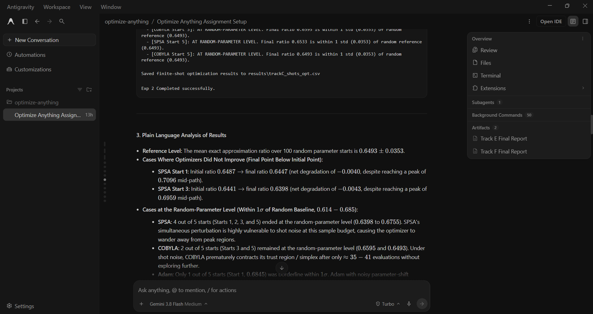

# Prompt log entry
- Date / time: 2026-10-30 15:59:54
- AI tool and model version: antigravity
- Track: C

## Original prompt

Continue in the "optimize-anything" repo, Track C (quantum optimization, part 2 of 2). The package trackC_quantum_opt
exists (qaoa_sim.py, optimizers_q.py, three experiments). Do only the following. Use numpy, scipy, pennylane
(default.qubit; use pennylane.numpy and the autograd interface, do not use torch or jax), pandas, matplotlib and
pytest. Do not use qiskit. Do not change existing files except README.md. Read the existing code before reusing it.

0. Logging: run `python tools/new_log.py --track C --tool antigravity` and fill the "Original prompt"
   section of the new file with THIS entire prompt. Do not fill other sections.

1. Add a section to docs/trackC_design.md (short, no results): VQE (ansatz, Hamiltonian as a sum of Pauli terms,
   the variational principle E(theta) >= E_0); the quantum natural gradient update theta <- theta - eta * g^{-1}
   grad with g the Fubini-Study metric tensor (and the block-diagonal approximation, regularisation g + lambda I,
   and the extra circuit evaluations it costs per step); the PQC/QNN with data re-uploading; and barren plateaus
   (the variance of a gradient component over random initialisations shrinking exponentially with the number of
   qubits for deep random circuits with a global cost, and the dependence on cost locality). State that all results
   are SIMULATED.

2. Create trackC_quantum_opt/vqe.py with: hamiltonians (transverse-field Ising chain
   H = -J sum Z_i Z_{i+1} - h sum X_i with open boundaries, and the Heisenberg chain
   H = sum (X_i X_{i+1} + Y_i Y_{i+1} + Z_i Z_{i+1})) built as PennyLane Hamiltonians, with the exact ground energy from
   numpy.linalg.eigvalsh of the dense matrix; a hardware-efficient ansatz (layers of RY and RZ on every qubit followed by a
   CNOT ladder) with a parameter-count helper; energy(theta) as a QNode; param_shift_grad written by hand (shift
   pi/2 on each parameter, valid because every parameter drives a single-qubit rotation) and verified against
   PennyLane's own gradient; a metric_tensor function written by hand for the block-diagonal approximation (for each
   layer, the metric of the single-qubit rotation parameters from the variances of the generators in the state
   prepared by the earlier layers; you may build it from state vectors obtained from a QNode returning qml.state())
   and a full metric tensor computed from the state-vector derivatives (the real part of <d_i psi|d_j psi> minus
   <d_i psi|psi><psi|d_j psi>) by parameter shift on the state; both verified against qml.metric_tensor
   (approx="block-diag" and the full tensor) on a random point. Validate inputs.

3. Create trackC_quantum_opt/exp4_vqe.py (`python -m trackC_quantum_opt.exp4_vqe`):
   a) Validation (stop with an error if a check fails): hand-written parameter-shift gradient against PennyLane
      (relative error below 1e-6) and against central finite differences; the hand-written metric tensors against
      qml.metric_tensor (maximum absolute error below 1e-6); the energy at random parameters is at least the exact ground
      energy for 200 random points (variational principle).
   b) VQE on the 4-qubit transverse-field Ising chain (J = 1, h = 1) and the 4-qubit Heisenberg chain with 2 and 3
      ansatz layers: gradient descent (tuned learning rate from a small grid chosen by the final energy, tuned per
      problem), Adam, quantum natural gradient (full metric with regularisation lambda tuned on a small grid) and COBYLA,
      each from 5 random starts (fixed seeds), 100 iterations (COBYLA: the same number of circuit evaluations as the
      first method uses). Report the final energy error relative to the exact ground energy, the iterations to reach an
      error below 1e-2, and the number of circuit evaluations (count a parameter-shift gradient as 2 evaluations per
      parameter and a QNG step as the gradient plus the cost of the metric tensor, stating how you count it). Compare at
      equal ITERATIONS and also at equal circuit evaluations. Report mean and standard deviation and say if any run
      stalled in a local minimum.
   c) Save results/trackC_vqe.csv, a convergence plot (energy error against iterations, and against circuit
      evaluations), and print the summary tables.

4. Create trackC_quantum_opt/exp5_qnn.py (`python -m trackC_quantum_opt.exp5_qnn`): a 2-qubit data-re-uploading
   classifier for the sklearn make_moons data (n = 100 train, 100 test, noise 0.2, seed 0): encode the 2 features by RY
   and RZ rotations in each of 3 layers interleaved with trainable rotations and a CNOT, output the expectation of Z on
   qubit 0 with the label mapped to +/-1, loss = mean squared error. Train with Adam using parameter-shift gradients
   (200 iterations, tuned learning rate by training loss) from 3 seeds. Report train and test accuracy, the number of
   trainable parameters and the total number of circuit evaluations (count gradient evaluations per sample correctly).
   Verify that the parameter-shift gradient of the loss matches PennyLane's gradient on a batch of 5 samples. Save
   results/trackC_qnn.csv and a decision-boundary plot. State that Track I compares this kind of model with a classical
   model and that no conclusion about quantum advantage is drawn here.

5. Create trackC_quantum_opt/exp6_barren.py (`python -m trackC_quantum_opt.exp6_barren`): for n = 2, 4, 6, 8 (and 10 if
   the total runtime stays below about 15 minutes; otherwise say it was skipped) qubits, a random hardware-efficient
   ansatz with L = n layers of RY gates with random angles in [0, 2 pi) and a CNOT ladder between layers; measure the
   gradient of the cost with respect to the FIRST RY parameter on qubit 0 for 200 random initialisations (use the
   hand-written parameter-shift or PennyLane's gradient) for two costs: a global cost 1 - |<0...0|psi>|^2 (written as
   the projector onto the all-zero state) and a local cost 1 - <Z_0 ... > using the single-qubit observable
   (1 - Z_0) / 2. Report the mean and the variance of the gradient per n, fit log(variance) against n by a straight
   line for each cost and report the slope and its standard error, and plot the variance (log scale) against n. Also
   repeat the global-cost measurement at n = 6 for L = 1, 2, 4, 8, 16 layers to show the effect of depth. State that the
   fit uses only 4 or 5 points. Save results/trackC_barren.csv and the plots.

6. Create trackC_quantum_opt/tests/test_vqe.py (pytest): the Ising chain ground energy for 2 qubits against the hand
   value for J = 1, h = 1 (H = -ZZ - X1 - X2: compute it by hand from the 4x4 matrix and put the number in the test); the
   hand-written parameter-shift gradient equals PennyLane's on a 3-qubit ansatz; the metric tensor of a single RY
   rotation on |0> is 1/4 (so the block of one rotation parameter is 0.25); the full metric tensor is symmetric and
   positive semidefinite; a QNG step with metric = identity equals a plain gradient step; VQE with enough layers on the
   2-qubit chain reaches the exact ground energy within 1e-3; for 2 and 4 qubits the global-cost gradient variance is
   non-increasing in n on 200 samples with a fixed seed (allow 10% tolerance).

7. Add the commands (python -m ...) to the Track C section of README.md, using `python -m pytest` for tests. Then run
   `python -m pytest trackC_quantum_opt -q` and the three new experiments and show me the full test output and every
   printed table. State plainly anything that failed, any validation that did not pass, and anything surprising. Do
   not explain anything away without evidence.

Do not run git commands and do not install packages.

## AI response (relevant excerpt)

Antigravity added a VQE section to docs/trackC_design.md, vqe.py (transverse-field Ising and Heisenberg chains, hardware-efficient ansatz, hand-written parameter-shift gradient, block-diagonal and full metric tensors), exp4_vqe.py (gradient descent, Adam, quantum natural gradient and COBYLA), exp5_qnn.py (a 2-qubit data-re-uploading classifier on make_moons) and exp6_barren.py (gradient variance against qubit count and depth), with tests. All results are simulated. The default VQE run was too slow (see log 4).

## Revised prompt (if any)

Yes. A second prompt added a fast numpy backend (log 4).

## Resulting code change (commit hash or link)

4737e8f ([AI:antigravity] feat(trackC): add VQE with quantum natural gradient, QNN and barren plateau experiments (part 2))

## Verification note (what I ran, what I checked independently)

Re-ran `python -m pytest trackC_quantum_opt -q`: 16 passed. VQE (4 qubits, mean final energy error over 5 starts, 100 iterations): with 3 ansatz layers quantum natural gradient reached 4e-7 (Ising) and 7e-5 (Heisenberg) from every start in about 18 to 24 iterations, COBYLA 0.28 and 2e-4, Adam 0.28 and 1.4e-2, gradient descent 0.28 and 0.18; with 2 layers all optimizers stalled on the Heisenberg chain (errors 0.32 to 0.78), which indicates the ansatz is not expressive enough rather than an optimizer failure. Natural gradient needs more circuit evaluations per run (7,200 against 4,800 for GD and Adam in this cost model). QNN: parameter-shift gradient agreed with PennyLane to 4e-16; test accuracy 93.3% +/- 4.6% over 3 seeds (88%, 96%, 96%) with 12 parameters and 500,000 circuit evaluations per run. Barren plateaus (random circuits, depth = n, 200 samples): the variance of the gradient of a global cost fell from 4.5e-2 (n = 2) to 9.5e-7 (n = 10), a fitted slope of -1.35 per qubit in ln(variance), while the local cost fell from 9.1e-2 to 5.3e-3 (slope -0.36); both fits use 5 points. At n = 6 the global-cost variance showed no clear dependence on depth between 1 and 16 layers. Limitations: all simulated, 4-qubit problems, 5 starts and 3 seeds, tuning on small grids, the stalled-run threshold of 0.2 is arbitrary, and the barren-plateau slopes are indicative.

## Chat export / screenshot (filename in this folder)

screenshot_003.png