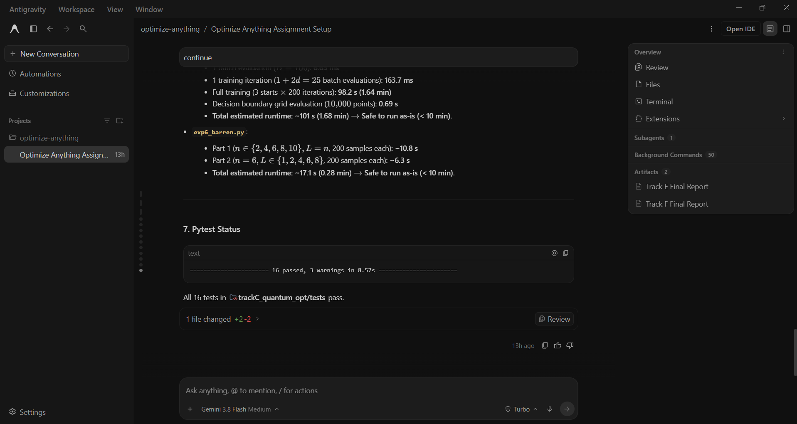

# Prompt log entry
- Date / time: 2026-10-30 17:28:10
- AI tool and model version: antigravity
- Track: C

## Original prompt

Continue in the "optimize-anything" repo, Track C part 2. `python -m trackC_quantum_opt.exp4_vqe` ran for more than
30 minutes without finishing. Do only the following. Do not change the physics, the validation checks or the
scientific meaning of any experiment.

0. Logging: run `python tools/new_log.py --track C --tool antigravity` and fill the "Original prompt"
   section of the new file with THIS entire prompt. Do not fill other sections.

1. Do not guess the cause. First measure, on the 4-qubit, 3-layer ansatz: the time of one energy evaluation, one
   hand-written parameter-shift gradient, and one full metric tensor with the current PennyLane-based code. From the
   counts in exp4_vqe.py (starts, problems, depths, optimizers, learning-rate and regularisation grids, iterations)
   compute and print the estimated total runtime. Say which part dominates.

2. Add a fast pure-numpy statevector backend in trackC_quantum_opt/vqe_fast.py for the same ansatz (RY and RZ layers
   and the CNOT ladder), with the Hamiltonian as a dense matrix built from the same Pauli terms, energy, the
   parameter-shift gradient, and the full metric tensor from state-vector derivatives. Keep the PennyLane code as the
   reference. In the validation part of exp4_vqe.py compare the fast backend with the PennyLane implementation
   (energy, gradient and metric tensor, maximum absolute difference below 1e-8 on 5 random points) and stop with an
   error if it fails. Use the fast backend for the optimization sweeps. Count circuit evaluations exactly as before
   (they are a cost model, not wall-clock time) and say so.

3. Add progress output to exp4_vqe.py: print a line with elapsed time after every (problem, depth, optimizer, start)
   run, with flush=True. Add a `--quick` option (3 starts, 50 iterations, smaller grids). The default run must finish
   in under 10 minutes; if the estimate says otherwise, reduce the tuning grids to 4 values each and say so in the
   output.

4. Do the same check for exp5_qnn.py and exp6_barren.py: print the estimated runtime before running, and if either is
   estimated above 10 minutes, speed it up with the same method or reduce the sweep, and report exactly what was
   reduced. Do not run them in this prompt; only run their estimate step.

5. Run `python -m pytest trackC_quantum_opt -q` and then `python -m trackC_quantum_opt.exp4_vqe`, and show me the
   timing measurements, the runtime estimate before and after, the validation output, the test result and the
   printed tables. State plainly anything that failed or was reduced.

Do not run git commands and do not install packages.

## AI response (relevant excerpt)

Antigravity measured that one PennyLane parameter-shift gradient takes about 536 ms for 24 parameters (about 7.7 ms per QNode call) and estimated the full VQE sweep at about 70 minutes. It added vqe_fast.py, a pure-numpy backend for the same ansatz, validated against the PennyLane implementation, plus progress output and a --quick option, and estimated the QNN and barren-plateau runtimes (about 100 s and 17 s).

## Revised prompt (if any)

None.

## Resulting code change (commit hash or link)

4737e8f (same commit as log 3).

## Verification note (what I ran, what I checked independently)

I stopped the original run after more than 30 minutes without output. After the change, the validation output reported that the fast backend matches PennyLane to about 1e-16 on energy, gradient and metric tensor (5 random points at 3 qubits, 3 points at 4 qubits and 3 layers), and the full sweep ran in about 68 s. I did not re-run PennyLane's full sweep for comparison. Circuit-evaluation counts are a cost model, not wall-clock time.

## Chat export / screenshot (filename in this folder)

screenshot_004.png