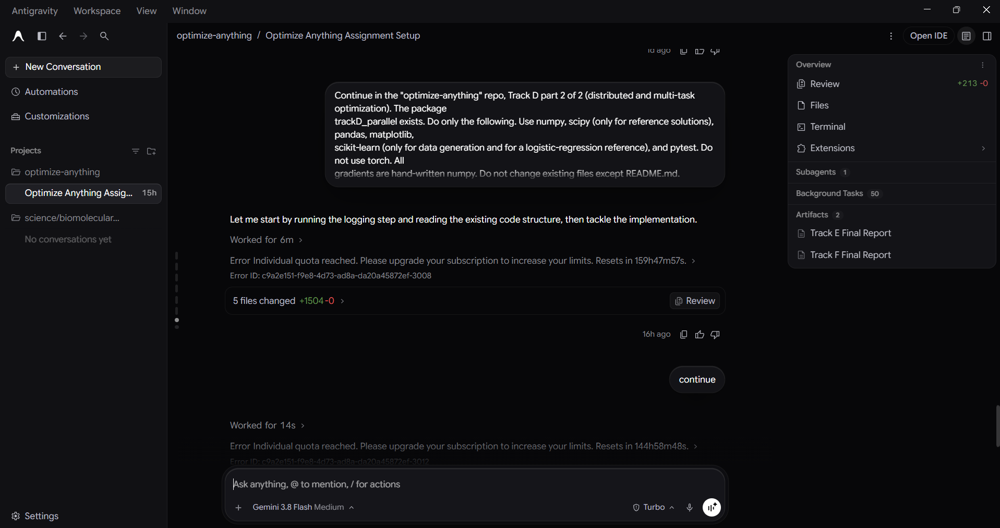

# Prompt log entry
- Date / time: 2026-11-04 20:15:58
- AI tool and model version: antigravity
- Track: D

## Original prompt
Continue in the "optimize-anything" repo, Track D part 2 of 2 (distributed and multi-task optimization). The package
trackD_parallel exists. Do only the following. Use numpy, scipy (only for reference solutions), pandas, matplotlib,
scikit-learn (only for data generation and for a logistic-regression reference), and pytest. Do not use torch. All
gradients are hand-written numpy. Do not change existing files except README.md.

0. Logging: run `python tools/new_log.py --track D --tool antigravity` and fill the "Original prompt"
   section of the new file with THIS entire prompt. Do not fill other sections.

1. Add a section to docs/trackD_design.md (short, no results): FedAvg (K clients with local data, each round the server
   sends the global weights, every selected client runs E local gradient steps with batch size B, the server averages the
   returned weights weighted by client data size; client drift under non-IID data; the communication cost as rounds times
   model size); MGDA (for two tasks the min-norm point of the convex hull of the gradients, closed form
   alpha* = clip(((g2 - g1) . g2) / ||g1 - g2||^2, 0, 1), direction d = alpha* g1 + (1 - alpha*) g2, which is a common
   descent direction unless it is zero, i.e. a Pareto-stationary point); GradNorm (task weights w_i updated to minimise
   sum_i |G_i - Gbar * r_i^alpha| where G_i = ||w_i grad_W L_i|| is the gradient norm of the weighted task loss with respect
   to the shared parameters, Gbar their mean, r_i the relative inverse training rate L_i(t) / L_i(0) normalised by its mean,
   the target treated as a constant, weights renormalised to sum to the number of tasks); and a statement that this is a
   SIMULATION of distributed training in a single process (no network, no real communication time).

2. Create trackD_parallel/federated.py: a synthetic federated binary classification problem (d = 20 features, K = 10
   clients, about 200 samples per client from numpy.random.default_rng(seed); a true weight vector; label noise; for
   non-IID data give each client a different label skew and a different feature shift, controlled by a parameter
   heterogeneity in [0, 1] where 0 is IID); a logistic-regression loss with L2 regularisation and hand-written gradient
   (verified against central finite differences in the tests); local_sgd(w, data, E, batch, lr, rng); fedavg(clients, rounds,
   E, batch, lr, participation, seed) returning the global loss, accuracy and communication volume (number of float values
   transmitted) after every round; centralized_sgd(all data pooled, the same total number of gradient steps) and
   centralized_gd for the exact reference minimiser (scipy.optimize.minimize with BFGS on the pooled objective). Validate inputs.

3. Create trackD_parallel/multitask.py: a two-task regression model with a shared linear layer W (d_in = 10, hidden = 8,
   tanh) and two linear heads, task 1 target y1 = a smooth function of the input with scale about 1 and task 2 target y2 with
   a scale about 20 times larger and a partly conflicting structure (generate it so that the task gradients have negative
   cosine similarity at initialisation for a good fraction of the data; report the measured cosine similarity), squared-error
   losses, hand-written backpropagation for all parameters (verified against finite differences in the tests), and these
   training methods with the same initialisation, data, number of steps and learning-rate grid: equal weighting
   (L1 + L2), MGDA (closed form for two tasks on the gradients with respect to ALL parameters of the shared layer, heads
   updated with their own task gradient), and GradNorm (as in item 1; weights learned with their own learning rate; update
   weights on the shared layer; heads use the weighted task gradient). Each method records per-step both task losses,
   the cosine between the two shared-layer task gradients, the weights (MGDA's alpha or GradNorm's w) and the norms.

4. Create trackD_parallel/exp3_federated.py (`python -m trackD_parallel.exp3_federated`):
   a) Check the gradient and the loss against the scipy reference on the pooled data (the BFGS minimum is the optimal loss
      L*); print the gap definitions. Check that FedAvg with E = 1, full participation, full-batch local steps and equal client
      sizes equals centralized gradient descent step for step (maximum weight difference below 1e-10; stop with an error
      otherwise), and say that this is the sanity check.
   b) FedAvg against centralized SGD with the same total gradient steps for heterogeneity in {0, 0.5, 1.0} and local steps
      E in {1, 5, 20} with 100 rounds, tuned learning rate (small grid per setting, chosen by the final training loss),
      5 seeds. Report the final loss gap to L*, the test accuracy on a held-out pooled test set, and the communication
      volume. Show the effect of the number of rounds (loss gap after 10, 25, 50 and 100 rounds) and of the participation
      fraction (all 10 clients against 3 randomly sampled per round) at E = 5 and heterogeneity 1.0.
   c) Print the tables and save results/trackD_federated.csv and plots (loss gap against rounds for the E values, loss gap
      against communication volume). State plainly where non-IID FedAvg plateaus above the centralized optimum
      (client drift) and where it does not.

5. Create trackD_parallel/exp4_multitask.py (`python -m trackD_parallel.exp4_multitask`):
   a) Print the measured gradient cosine similarity at initialisation and the loss scales of the two tasks.
   b) For each of the three methods, tune the learning rate on a small grid (by the final SUM of the two task losses
      normalised by their initial values, so that the large task does not dominate the selection), 5 seeds, 500 steps. Report the
      final loss of each task (raw and relative to the initial loss), the sum of relative losses, the worst-task relative
      loss, the fraction of steps in which each task loss increased (the conflict that MGDA is meant to avoid), and the mean
      MGDA alpha and the mean GradNorm weights over training.
   c) Verify numerically, at 50 random parameter points, that the MGDA direction has a non-negative inner product with both
      task gradients (print the minimum of both inner products; both must be >= -1e-12, otherwise stop with an error), and
      that when the two gradients point the same way the MGDA direction equals the one with the smaller norm.
   d) Print the tables and save results/trackD_multitask.csv and plots (task losses against steps for the three methods and
      the weights over time). Do not claim a method is better in general: report what these runs show and note the limits
      (one synthetic problem, tuned on the same data, 5 seeds).

6. Create trackD_parallel/tests/test_d2.py (pytest, fast): the federated gradient equals finite differences; FedAvg with
   E = 1, full participation and full-batch equals centralized gradient descent; the multitask backpropagation equals finite
   differences for every parameter group; the MGDA closed form gives the global minimum of ||alpha g1 + (1 - alpha) g2||^2 on
   a grid of alphas for 20 random gradient pairs; MGDA returns zero for exactly opposite equal-norm gradients; GradNorm
   weights stay positive and sum to the number of tasks; each method decreases the equal-weight total loss on the synthetic
   problem within 200 steps.

7. Add the run commands (python -m ...) to the Track D section of README.md, using `python -m pytest` for tests. Print an
   estimate of the runtime of each experiment before running it; if either exceeds 5 minutes reduce the sweep and say what
   was reduced. Print progress lines with flush=True. Then run `python -m pytest trackD_parallel -q` and both experiments and
   show me the full test output and every printed table. State plainly anything that failed, any method that did worse than
   equal weighting, and anything surprising. Do not explain anything away without evidence.

Do not run git commands and do not install packages.

## AI response (relevant excerpt)

Antigravity started the task and stopped when it hit its usage limit. It left partial code (federated.py, multitask.py, exp3_federated.py, exp4_multitask.py, tests/test_d2.py) and this log with a blank Original prompt section; I filled the prompt in afterwards from my records. The partial work was committed as a WIP commit and handed over to Codex (log 003).

## Revised prompt (if any)

Continued with Codex (log 003).

## Resulting code change (commit hash or link)

01be416 ([AI:antigravity] wip(trackD): partial FedAvg/MGDA/GradNorm work, stopped by usage limit)

## Verification note (what I ran, what I checked independently)

The partial code was not verified by me before handover. Codex later found that local_sgd did not perform exactly E steps (failure log row 20) although the 7 tests passed.

## Chat export / screenshot (filename in this folder)

screenshot_002.png
