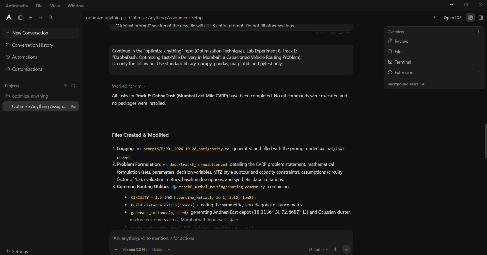

# Prompt log entry
- Date / time: 2026-10-28 01:05:16
- AI tool and model version: antigravity
- Track: E

## Original prompt

Continue in the "optimize-anything" repo (Optimization Techniques, Lab Experiment 8, Track E:
"DabbaDash: Optimizing Last-Mile Delivery in Mumbai", a Capacitated Vehicle Routing Problem).
Do only the following. Use standard library, numpy, pandas, matplotlib and pytest only.

0. Logging: run `python tools/new_log.py --track E --tool antigravity` and fill the
   "Original prompt" section of the new file with THIS entire prompt. Do not fill other sections.

1. Create docs/trackE_formulation.md containing:
   - Problem statement (last-mile delivery, one depot in Andheri East, N customers in Mumbai, homogeneous
     vehicles of capacity Q, unlimited fleet size, minimize total distance).
   - Mathematical formulation: sets, parameters (distance d_ij, demand q_i, capacity Q), decision variables
     (x_ij binary arc usage, u_i load/position variable), objective, and constraints
     (each customer visited exactly once, flow conservation, capacity via MTZ-style load constraints, routes start and end at the depot).
   - Assumptions: synthetic data, haversine distance times a circuity factor of 1.3, constant speed ignored
     (distance is the metric), demand integers 1-9, Q = 50, no time windows in the baseline.
   - Metrics: total distance (km), number of vehicles, runtime (s), feasibility.
   - Baselines: (a) "driver order": visit customers in index order, start a new route whenever the next customer
     would exceed capacity; (b) nearest-neighbour: from the current location go to the nearest unvisited customer
     that fits in the remaining capacity, return to the depot when none fits.
   - A "Limitations" section stating that the data is synthetic.
   Do not write any results into this file yet.

2. Create trackE_mumbai_routing/routing_common.py with:
   - haversine_km(lat1, lon1, lat2, lon2) and a function building the full distance matrix
     (haversine * CIRCUITY = 1.3, CIRCUITY as a named constant).
   - generate_instance(n, seed): depot fixed at Andheri East (19.1136, 72.8697); customers sampled from a mixture
     of Gaussian clusters around Andheri, Bandra, Powai, Borivali, Dadar and Ghatkopar (sigma about 0.012 degrees),
     clipped to the box lat 18.95-19.25, lon 72.80-72.98; demands integers 1-9; capacity Q = 50.
     Use numpy.random.default_rng(seed). Return a dict/dataclass with coords, demands, capacity, depot index 0.
     Validate inputs (n >= 1, seed is an int).
   - route_cost(route, dist) and solution_cost(routes, dist).
   - validate_solution(instance, routes) that INDEPENDENTLY checks: every customer appears exactly once, every
     route starts and ends at the depot, and no route exceeds capacity. Return (is_valid, list_of_error_messages).
     It must not reuse any code from the solvers.

3. Create trackE_mumbai_routing/baselines.py with driver_order(instance) and nearest_neighbour(instance),
   each returning a list of routes (each route is a list of node indices starting and ending with 0).
   Comment the logic clearly.

4. Create trackE_mumbai_routing/run_baseline.py that, for n in [10, 20, 50, 100, 200] and seeds 0-4,
   runs both baselines, validates every solution (stop with an error if any is invalid), records total distance
   in km, number of vehicles, and runtime in seconds (time.perf_counter), and writes results/trackE_baseline.csv
   with columns: method, n, seed, distance_km, vehicles, runtime_s, valid.
   Also write results/trackE_environment.json with Python version, OS, CPU name/count (platform, os.cpu_count)
   and the library versions used. Print a summary table of mean +/- std distance per method and n.
   Finally save results/trackE_baseline_map.png: a scatter/route plot for n=50, seed 0 showing the depot,
   customers, and the nearest-neighbour routes in different colours.

5. Create trackE_mumbai_routing/tests/test_routing.py (pytest) with tests for:
   haversine of a known pair of points (within a sensible tolerance), the distance matrix being symmetric with zero diagonal,
   generate_instance being deterministic for the same seed and different for different seeds,
   validate_solution accepting a hand-made valid solution and rejecting (a) a missing customer, (b) a duplicated customer,
   (c) a capacity violation, and both baselines producing valid solutions for n = 10 and n = 50.
   Add a tiny hand-checkable example (3 customers with fixed coordinates/demands) where the expected route cost
   is computed independently in the test.

6. Add a "Track E" section to README.md describing how to run:
   python trackE_mumbai_routing/run_baseline.py   and   pytest trackE_mumbai_routing/tests

Do not run git commands and do not install packages. After creating the files, run pytest and
run_baseline.py, and show me the full output including the summary table.

## AI response (relevant excerpt)

Antigravity created docs/trackE_formulation.md (CVRP statement, MTZ-style formulation, assumptions, metrics, baselines, limitations), trackE_mumbai_routing/routing_common.py (haversine with circuity factor 1.3, distance matrix, seeded instance generator, route cost, independent validate_solution), baselines.py (driver_order and nearest_neighbour), run_baseline.py (n in 10/20/50/100/200, seeds 0-4, writes CSV, environment JSON and a map), tests/test_routing.py and a Track E section in the README. It ran pytest and the baseline runner and showed the output.

## Revised prompt (if any)

None.

## Resulting code change (commit hash or link)

9b89840 ([AI:antigravity] feat(trackE): add CVRP formulation, instance generator, baselines and tests)

## Verification note (what I ran, what I checked independently)

Ran `pytest trackE_mumbai_routing/tests`: 7 passed. Ran `python trackE_mumbai_routing/run_baseline.py`: all 50 solutions (2 methods x 5 sizes x 5 seeds) passed the validator. Mean distance, driver_order vs nearest_neighbour (km): n=10 121.25 vs 96.56; n=20 266.50 vs 131.23; n=50 647.38 vs 266.74; n=100 1328.69 vs 444.69; n=200 2612.89 vs 681.51. Driver order follows random customer indices, so it is a deliberately weak baseline; later methods are judged mainly against nearest-neighbour.

Independent checks: recomputed the 3-customer hand-checkable test by hand (0.01 degree of longitude on the equator = 1.111949 km, times circuity 1.3 = 1.445534 km per step; 8 steps = 11.564272 km), which matches the test's asserted value, and the test target is built from this geometry, not from route_cost. Read validate_solution: it checks that each customer appears exactly once, that routes start and end at depot 0, and that capacity is respected, with no dependency on baselines.py. Corrupted solutions on a generated n=50 instance (missing customer, duplicated customer, capacity overflow, missing depot at start) were all rejected with sensible error messages. Minor observation: in the missing-depot case the validator also reports the first customer as missing, which suggests it reads customers from route[1:-1]; the solution is still correctly rejected. No AI errors found in this step.

## Chat export / screenshot (filename in this folder)

screenshot_001.png
