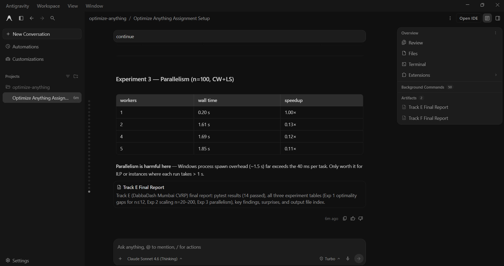

# Prompt log entry
- Date / time: 2026-10-29 16:43:15
- AI tool and model version: antigravity
- Track: E

## Original prompt
Continue in the "optimize-anything" repo, Track E (DabbaDash CVRP). trackE_mumbai_routing/routing_common.py
(instance generator, distance matrix, validate_solution), baselines.py, run_baseline.py and
results/trackE_baseline.csv already exist. Do only the following. Use numpy, pandas, matplotlib, ortools
(pywraplp SCIP for the ILP, ortools.constraint_solver.pywrapcp for the routing reference) and pytest.
Do not use pulp. Do not change the existing generator, validator or baselines.

0. Logging: run `python tools/new_log.py --track E --tool antigravity` and fill the "Original prompt"
   section of the new file with THIS entire prompt. Do not fill other sections.

1. Create trackE_mumbai_routing/solvers.py with:
   - clarke_wright(instance): parallel savings algorithm (savings s_ij = d_0i + d_0j - d_ij, merge routes at
     their ends when capacity allows), returning routes as lists starting and ending at depot 0.
   - local_search(instance, routes): repeat until no improvement: intra-route 2-opt, inter-route relocate (move one
     customer to another route) and inter-route swap, accepting only moves that keep capacity and reduce total
     distance (first-improvement, deterministic order). Also return the number of improving moves made.
   - ilp_cvrp(instance, time_limit_s): exact formulation with binary arc variables x_ij, degree constraints,
     MTZ load variables u_i (d_i <= u_i <= Q, u_j >= u_i + q_j - Q(1 - x_ij)), a fixed upper bound on the number of
     vehicles equal to the number of routes in the Clarke-Wright solution, solved with OR-Tools pywraplp SCIP and the
     time limit. Return the routes, the objective, whether it proved optimality, and the solver status.
   - ortools_routing(instance, time_limit_s): the OR-Tools routing solver (guided local search) with a capacity
     dimension, using integer-scaled distances (multiply by 1000 and round); return routes and the true
     distance recomputed from the unscaled matrix. State in the docstring that this is a library reference.
   Every returned solution must pass validate_solution (call it inside a wrapper and raise if invalid).

2. Create trackE_mumbai_routing/run_comparison.py (`python -m trackE_mumbai_routing.run_comparison`):
   - ILP and exact comparison: for n in {8, 10, 12} and seeds 0-4, run ILP (time limit 60 s) and report whether it
     proved optimality. For the instances it solved to optimality, report the optimality gap (in percent) of
     driver_order, nearest_neighbour, clarke_wright, clarke_wright + local_search and ortools_routing (10 s).
     Stop with an error if any heuristic beats a PROVEN-optimal ILP value by more than 1e-6.
   - Scaling: for n in {20, 50, 100, 200} and seeds 0-4, run driver_order, nearest_neighbour, clarke_wright,
     clarke_wright + local_search and ortools_routing (time limit 10 s, 30 s for n = 200). Use the same instances as
     results/trackE_baseline.csv (same generator and seeds) and report mean and standard deviation of distance,
     number of vehicles, runtime in seconds, and the percentage improvement versus nearest_neighbour (the main
     baseline) and versus driver_order. Add the ILP for n = 20 with a 120 s time limit and report whether it
     proved optimality or only the best bound found.
   - Parallelism: run the 5 seeds for one configuration (n = 100, clarke_wright + local_search) sequentially and with
     multiprocessing (2, 4 and as many processes as os.cpu_count() allows), and report speedup and parallel efficiency
     (speedup / processes). State that the work is embarrassingly parallel across instances and not within one solve.
   - Save results/trackE_comparison.csv (columns: method, n, seed, distance_km, vehicles, runtime_s, valid,
     proved_optimal) and results/trackE_scaling.png (distance and runtime versus n), plus
     results/trackE_routes_n50.png showing the nearest-neighbour and the clarke_wright + local_search routes side
     by side for n = 50, seed 0. Print every summary table.

3. Create docs/trackE_strategy.md: a strategy-selection table with one row per method (driver_order, nearest
   neighbour, Clarke-Wright, Clarke-Wright + local search, ILP exact, OR-Tools routing) and columns: variable type,
   problem size where usable, exact or heuristic, hardware used, parallelism, main limitation. Fill the cells
   only from measured facts in this experiment or standard knowledge, and mark each cell that is not measured
   as "not measured". Then add sections on: what was assumed (synthetic data, circuity factor 1.3, no time windows),
   when each method should be used if the scale, constraints (time windows, heterogeneous fleet) or hardware changed,
   and why QUBO/QAOA-style formulations were not applied to the main problem (size and constraint encoding cost).
   Do not write results claims that the experiment did not produce.

4. Create trackE_mumbai_routing/tests/test_solvers.py (pytest): all four solvers return valid solutions on n = 10 and
   n = 50; clarke_wright is deterministic; local_search never increases the distance and keeps validity; on a
   hand-built instance with two clusters far apart and capacity forcing two routes, Clarke-Wright returns the
   obvious optimal two-route solution with a hand-computed cost; the ILP on a 5-customer instance matches brute-force
   enumeration over all customer permutations split into feasible routes; ortools_routing returns a valid solution.

5. Add the run commands (python -m ...) to the Track E section of README.md, using `python -m pytest` for tests.
   Then run `python -m pytest trackE_mumbai_routing -q` and `python -m trackE_mumbai_routing.run_comparison` and
   show me the test output and every printed table. State plainly anything that failed, any ILP that did not
   finish, and anything surprising. Do not explain anything away without evidence.

Do not run git commands and do not install packages.

## AI response (relevant excerpt)

Antigravity added trackE_mumbai_routing/solvers.py (Clarke-Wright savings, local search with 2-opt, relocate and swap, exact MTZ ILP with OR-Tools SCIP, OR-Tools routing reference), run_comparison.py, tests/test_solvers.py (14 tests with the earlier ones) and docs/trackE_strategy.md. It ran the comparison and reported results. Some of its conclusions were stronger than the experiments support (failure log row 15).

## Revised prompt (if any)

None.

## Resulting code change (commit hash or link)

4d1c7b9 ([AI:antigravity] feat(trackE): add Clarke-Wright, local search, ILP and OR-Tools comparison)

## Verification note (what I ran, what I checked independently)

Re-ran `python -m pytest trackE_mumbai_routing -q`: 14 passed. The AI reported that the exact ILP proved optimality on all 15 small instances (n = 8, 10, 12; 5 seeds each), where the mean optimality gap was 0.0% for OR-Tools, 0.0% to 0.7% for Clarke-Wright with local search, 0.7% to 1.1% for Clarke-Wright alone, 10% to 38% for nearest-neighbour and 47% to 88% for driver order, and that the script stops if a heuristic beats a proven optimum (none did). At larger sizes (mean distance in km, n = 20 / 50 / 100 / 200): nearest-neighbour 131.2 / 266.7 / 444.7 / 681.5, Clarke-Wright with local search 96.5 / 166.9 / 296.2 / 514.8, OR-Tools (10 s, 30 s at n = 200) 95.4 / 165.8 / 317.3 / 540.2. The nearest-neighbour numbers match my Day 1 baseline. The MTZ ILP proved optimality for only 1 of 5 instances at n = 20 within 120 s. Parallel runs across seeds were slower than sequential (speedup 0.11x to 0.13x) because each task takes about 40 ms and Windows process start-up dominates. Limitations: synthetic data, OR-Tools time limits of 10 s and 30 s, OR-Tools uses distances scaled by 1000 and rounded, the ILP at n = 20 is time-limited and unproven, the parallel result is for tiny tasks only, single machine, 5 seeds.

## Chat export / screenshot (filename in this folder)

screenshot_002.png