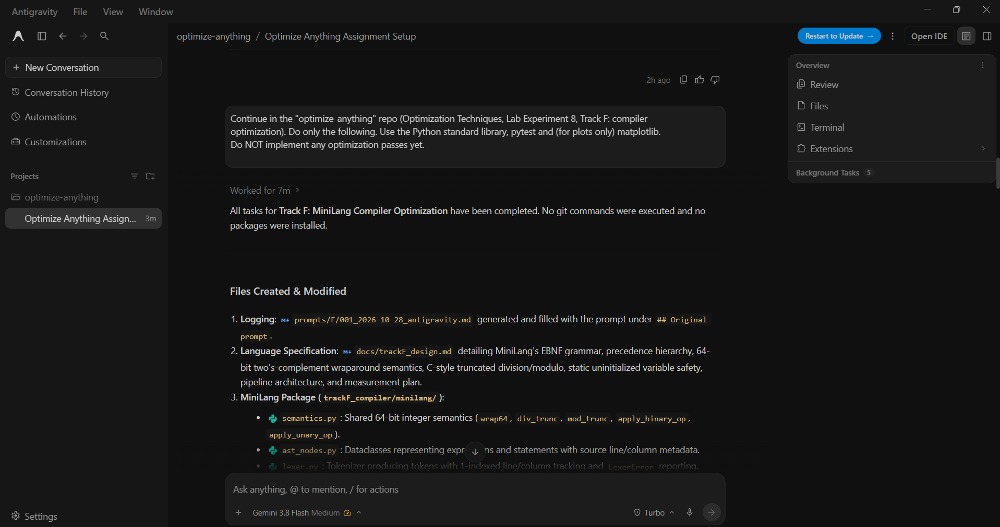

# Prompt log entry
- Date / time: 2026-10-28 02:52:18
- AI tool and model version: antigravity
- Track: F

## Original prompt

Continue in the "optimize-anything" repo (Optimization Techniques, Lab Experiment 8, Track F: compiler
optimization). Do only the following. Use the Python standard library, pytest and (for plots only) matplotlib.
Do NOT implement any optimization passes yet.

0. Logging: run `python tools/new_log.py --track F --tool antigravity` and fill the "Original prompt"
   section of the new file with THIS entire prompt. Do not fill other sections.

1. Create docs/trackF_design.md describing MiniLang:
   - Grammar (EBNF): statements are assignment, print, if/else, while, blocks with braces; expressions with
     integer literals, variables, unary minus, + - * / %, comparisons (< <= > >= == !=). Precedence:
     comparison lowest, then + -, then * / %, then unary minus. Statements end with ';'.
   - Semantics: all values are 64-bit signed integers with two's-complement wraparound; division and modulo
     truncate toward zero (C semantics); division or modulo by zero is a runtime error; comparisons give 0 or 1;
     if/while treat nonzero as true; uninitialised variable use is a compile-time error; print outputs one integer per line.
   - Pipeline description (lexer, parser, AST, IR, codegen, VM) and the measurement plan
     (static instruction count, dynamic instruction count, runtime, compile time).
   Write no results yet.

2. Create the package trackF_compiler/minilang/ with these modules, each small and commented:
   - lexer.py (tokens with line/column, clear error messages),
   - ast_nodes.py (dataclasses),
   - parser.py (recursive descent, errors with line/column),
   - semantics.py: ONE helper module with wrap64(x), div_trunc(a, b), mod_trunc(a, b) used by every
     component so all of them share the same arithmetic semantics,
   - ast_interp.py: a tree-walking reference interpreter that works directly on the AST and does not use the IR, codegen or VM,
   - ir.py: linear three-address code with virtual registers (t0, t1, ...), named variables, labels and jumps,
     and a text dump function,
   - irgen.py: AST to IR (short, explicit lowering of if/while to labels and conditional jumps),
   - codegen.py: IR to a VM program (a list of instruction tuples) and a text assembly dump,
   - vm.py: a VM that executes the program with a register/variable store, counts every executed instruction
     (dynamic count) and returns the output list; division by zero raises a clear error,
   - compiler.py: pipeline functions compile(source, opt_level=0) returning IR, the VM program and stats
     (static instruction count, compile time via time.perf_counter), plus a CLI:
       python -m trackF_compiler.minilang.compiler FILE.ml [--dump-ir] [--dump-asm] [--run] [--oracle]
     opt_level other than 0 must raise NotImplementedError for now.
   Validate inputs everywhere. Keep each module under about 250 lines.

3. Create trackF_compiler/programs/ with these MiniLang benchmark programs (each prints its results):
   - bench_sum.ml: sum of i for i = 1..100000 (expected output 5000050000)
   - bench_fib.ml: iterative Fibonacci, print fib(30) (expected 832040)
   - bench_primes.ml: count primes below 2000 by trial division (expected 303)
   - bench_invariant.ml: nested loops with a loop-invariant expression such as (a*b + c*d) recomputed inside the inner loop
   - bench_redundant.ml: repeated common subexpressions and constant arithmetic such as 2*3+4 inside a loop,
     plus dead assignments whose values are never used
   - bench_mixed.ml: if/else inside a while loop combining the above patterns
   Keep each program short and deterministic. The expected values written above are for me to verify
   independently; do not hard-code them as answers anywhere in the compiler.

4. Create trackF_compiler/run_baseline.py: for every program, compile at opt_level 0 and run it on
   (a) the AST oracle and (b) the VM. Assert that the two outputs are identical (stop with an error if not).
   Record static instruction count, dynamic instruction count, VM runtime (median of 5 runs), and compile time
   (median of 5 runs), and write results/trackF_baseline.csv with columns:
   program, static_instr, dynamic_instr, vm_runtime_s, compile_time_s, output_match.
   Also write results/trackF_environment.json (Python version, OS, CPU count) and print a summary table.

5. Create trackF_compiler/tests/test_minilang.py (pytest) covering: lexer tokens and errors; operator precedence;
   wrap64, div_trunc and mod_trunc on known values (-7/2 = -3, -7%2 = -1, overflow wraparound at 2**63);
   division by zero error; uninitialised-variable error; if/else and while on tiny programs with hand-computed output;
   and that the oracle and the VM produce identical output for EVERY program in trackF_compiler/programs/.

6. Add a "Track F" section to README.md with the run commands:
   python trackF_compiler/run_baseline.py   and   pytest trackF_compiler/tests

Do not run git commands and do not install packages. When done, run pytest and run_baseline.py and show
me the full output including the summary table.

## AI response (relevant excerpt)

Antigravity created docs/trackF_design.md (MiniLang grammar, 64-bit wraparound semantics, truncating division, pipeline and measurement plan), the trackF_compiler/minilang package (semantics, ast_nodes, lexer, parser, ast_interp, ir, irgen, codegen, vm, compiler), six benchmark programs, run_baseline.py, a pytest suite and a Track F README section. It ran pytest and the baseline runner and showed the output.

## Revised prompt (if any)

None.

## Resulting code change (commit hash or link)

d7cc32a ([AI:antigravity] feat(trackF): add MiniLang compiler pipeline, oracle, benchmarks and baseline)

## Verification note (what I ran, what I checked independently)

Ran `pytest trackF_compiler/tests`: 7 passed. Ran `python trackF_compiler/run_baseline.py` (opt_level 0): the AST oracle and the VM produced identical output for all six programs. Static / dynamic instruction counts and VM runtime (median of 5): bench_fib 27 / 524 / 0.000105 s; bench_invariant 46 / 2,103,018 / 0.5367 s; bench_mixed 90 / 1,030,018 / 0.2962 s; bench_primes 48 / 281,705 / 0.0755 s; bench_redundant 61 / 1,100,010 / 0.3004 s; bench_sum 19 / 1,300,010 / 0.3161 s. Dynamic counts far exceed static counts for the loop programs, and runtime is roughly proportional to dynamic count (about 200-290 ns per VM instruction), so dynamic instruction count will be the primary metric for the optimization comparison. Caveat: the oracle and the VM share semantics.py, so their agreement would not expose an error in the shared arithmetic helpers; the checks below address this. Independent checks: computed the expected outputs in plain Python (sum 1..100000 = 5000050000, fib(30) = 832040, primes below 2000 = 303) and the compiler output matched for all three. A hand trace of `x = 2 + 3 * 4` showed the IR multiplying before adding and printing 14. `print -7 / 2; print -7 % 2;` printed -3 and -1, which is C-style truncation, not Python's -4 and 1. ast_interp.py imports only ast_nodes and semantics, nothing from irgen, codegen or vm. The benchmark programs contain the intended optimization targets (loop-invariant expression in bench_invariant; constant arithmetic, repeated subexpressions and dead stores in bench_redundant). Test coverage: 7 tests covering lexing, precedence, arithmetic helpers, division by zero, uninitialised variables, control flow and oracle-vs-VM equivalence; parser error line/column reporting is not tested. Observation for Day 2: the unoptimized IR stores a variable and immediately reloads it, a redundancy a pass could remove. No AI errors found in this step.

## Chat export / screenshot (filename in this folder)

screenshot_001.png
