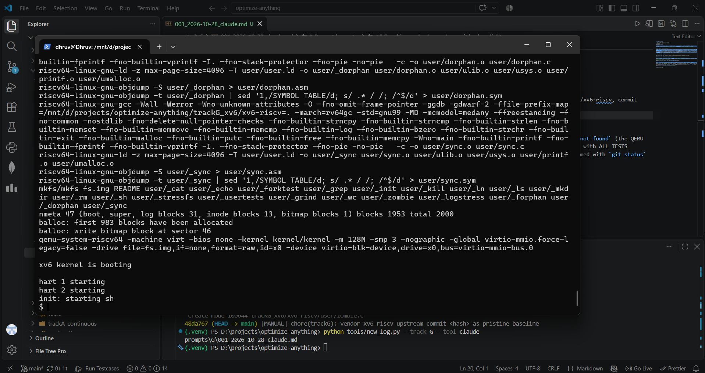
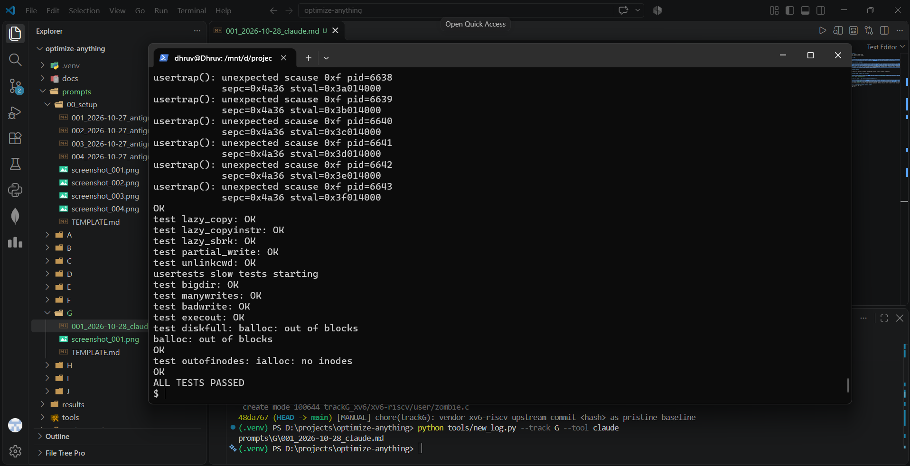

# Prompt log entry
- Date / time: 2026-10-28 02:26:23
- AI tool and model version: claude
- Track: G

## Original prompt

Asked Claude to guide the Track G environment setup: install WSL Ubuntu, install the QEMU and RISC-V toolchain, vendor the MIT xv6-riscv source into the repo as a pristine baseline, build it and run usertests. No code was generated in this step.

## AI response (relevant excerpt)

Claude gave the step-by-step setup commands: install Ubuntu under WSL2, apt packages (qemu-system-misc, gcc-riscv64-linux-gnu, binutils-riscv64-linux-gnu, git, build-essential), clone xv6-riscv, remove its nested .git so the outer repo tracks the files, run `make qemu` and `usertests` inside xv6, and commit only source files. Claude also diagnosed three setup problems from pasted output: `wsl -l -v` showing no distribution; Ubuntu first-run user creation failing with E_UNEXPECTED (worked around by logging in as root and creating the user manually); and `usertests` being an xv6 program rather than an Ubuntu command.

## Revised prompt (if any)

None for the main task. Follow-up prompts were pasted terminal errors, answered with fixes.

## Resulting code change (commit hash or link)

48da767 ([MANUAL] chore(trackG): vendor xv6-riscv upstream commit e93dabeb98431235c6e1a101cb96c73c923fdbc4 as pristine baseline). Upstream: mit-pdos/xv6-riscv, commit e93dabeb98431235c6e1a101cb96c73c923fdbc4, dated Mon Oct 26 17:16:16 2026 -0400. Verified identical to the vendored copy with `diff -r` against a fresh clone of upstream.

## Verification note (what I ran, what I checked independently)

Ubuntu 26.04.1 LTS on WSL2. QEMU 10.2.1, riscv64-linux-gnu-gcc 15.2.0. `make qemu` first failed with `qemu-system-riscv64: not found` (the QEMU binary was missing), fixed by installing the RISC-V QEMU package. Then ran xv6 under QEMU and `usertests`: the output ended with ALL TESTS PASSED, and the run took about 5 minutes 26 seconds (stopwatch, single run, so only a rough figure). This is the unmodified baseline against which all Track G changes will be compared. Screenshots were taken from a second run; the first run's result was ALL TESTS PASSED as recorded above. Confirmed with `git status` that no build artifacts were committed. No AI code was generated in this step, so there is no AI error to log.

## Chat export / screenshot (filename in this folder)

screenshot_001a.png (xv6 boot banner)

screenshot_001b.png (usertests: ALL TESTS PASSED)