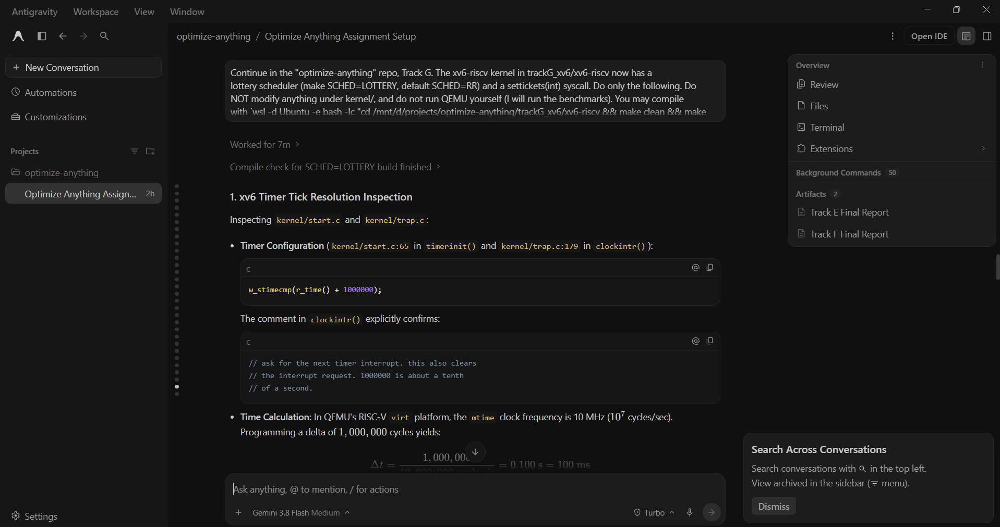

# Prompt log entry
- Date / time: 2026-10-29 21:22:06
- AI tool and model version: antigravity
- Track: G

## Original prompt

Continue in the "optimize-anything" repo, Track G. The xv6-riscv kernel in trackG_xv6/xv6-riscv now has a
lottery scheduler (make SCHED=LOTTERY, default SCHED=RR) and a settickets(int) syscall. Do only the following. Do
NOT modify anything under kernel/, and do not run QEMU yourself (I will run the benchmarks). You may compile
with `wsl -d Ubuntu -e bash -lc "cd /mnt/d/projects/optimize-anything/trackG_xv6/xv6-riscv && make clean && make
kernel/kernel fs.img 2>&1 | tail -30 && make clean"` (and the same with SCHED=LOTTERY) to check that it builds.

0. Logging: run `python tools/new_log.py --track G --tool antigravity` and fill the "Original prompt"
   section of the new file with THIS entire prompt. Do not fill other sections.

1. Read kernel/start.c (or wherever the timer interrupt interval is set) and kernel/trap.c to find how long one
   xv6 tick is, and state it in docs/trackG_design.md as the time resolution of uptime(). Do not assume.

2. Create trackG_xv6/xv6-riscv/user/schedbench.c (and add `$U/_schedbench\` to UPROGS in the Makefile; that is the only
   Makefile change) using only xv6 user-level calls (fork, wait, pipe, read, write, uptime, settickets, exit, printf).
   It runs three workloads, each repeated 5 times, and prints one machine-readable line per measurement, starting
   with `RESULT,`, then a final line `BENCH_DONE`. Children report results to the parent through a pipe; children
   never print RESULT lines themselves. Use a volatile counter spin loop as the CPU work, checking uptime() only every
   10000 iterations so that the syscall cost does not dominate. Write comments explaining each workload.
   - Calibration (once at the start): run the spin loop alone for 20 ticks and record iterations per tick; print
     `RESULT,calib,0,iters_per_tick,<value>`.
   - W1 proportional share: fork 3 CPU-bound children with tickets 30, 20, 10 (each calls settickets before
     starting). Each spins until a common deadline 60 ticks after the start and returns its iteration count. The
     parent prints, per repetition, `RESULT,w1,<rep>,work_t30,<n>,work_t20,<n>,work_t10,<n>`.
   - W2 turnaround: fork 4 CPU-bound "hog" children (tickets 10 each) that spin for 100 ticks, and one short job
     with a fixed amount of work equal to 15 ticks of calibrated single-process work (iterations = 15 * iters_per_tick).
     Run two variants per repetition, one after the other, with all processes started together: (a) the short job
     keeps tickets 10; (b) the short job calls settickets(40). Record the short job's completion time in ticks from
     the common start. Print `RESULT,w2,<rep>,variant,<a|b>,turnaround_ticks,<n>`. Wait for all hogs to finish before
     the next variant.
   - W3 fairness: fork 8 children with equal tickets (10) that spin until a common deadline 60 ticks after the start;
     print `RESULT,w3,<rep>,works,<n1>,<n2>,...,<n8>`.
   Under the default RR build settickets only stores a value; the program must run unchanged on both builds.
   Use int or uint64 iteration counters (make sure 32-bit overflow cannot happen over 100 ticks) and print 64-bit values
   correctly (xv6 printf has no %lu: print with %d only if the value fits, otherwise write a small helper).

3. Create trackG_xv6/run_bench.py (Python 3 standard library only; it will be run inside WSL Ubuntu as
   `python3 trackG_xv6/run_bench.py` from the repo root). For SCHED in [RR, LOTTERY]: run `make clean`, start
   `make qemu SCHED=<sched> CPUS=1` in the xv6-riscv folder with subprocess.Popen (stdin and stdout pipes, text mode),
   read output until the shell prompt "$ " appears, send "schedbench\n", read until a line BENCH_DONE (overall
   timeout 20 minutes, kill QEMU if exceeded), then send Ctrl-a x (the bytes b"\x01x"), wait up to 10 s and kill if it
   did not exit, then run `make clean`. Save the raw console output to results/trackG_raw_<sched>.txt. Parse the RESULT
   lines into results/trackG_bench.csv (columns: sched, workload, rep, metric, value) and print summary tables
   (mean and standard deviation over the 5 repetitions):
   - W1: for each ticket class, the observed work share (its work divided by the sum of all three) against the
     expected ticket share (0.5, 0.333, 0.167) for LOTTERY and against 1/3 for RR, and the mean absolute error between
     observed and ticket shares.
   - W2: mean and standard deviation of turnaround ticks for variants a and b, for both schedulers.
   - W3: Jain's fairness index (sum x)^2 / (n * sum x^2) per repetition, its mean and standard deviation, and the
     coefficient of variation of the 8 works, for both schedulers.
   Print the QEMU version and the exact commands used. The script must never leave a QEMU process running.

4. Create docs/trackG_design.md (short, no results): the OS concepts involved (process scheduling, the scheduler's
   run queue scan, context switch via swtch, spinlocks around p->lock), the objectives (proportional-share fairness,
   turnaround time of a short job, variance of CPU share), the three workloads, the single-CPU choice and why, the
   measured tick length from item 1, and the limitations (fixed-seed xorshift generator, tick resolution of
   uptime(), QEMU timing is not real hardware timing, results depend on the host load, only 5 repetitions).

5. Add the run command to the Track G section of README.md. Then show me the compile check output for both builds and
   list every file you created or changed. Do not run git commands and do not install packages.

## AI response (relevant excerpt)

Antigravity inspected the timer configuration (one tick is 100 ms: 1,000,000 cycles at 10 MHz), added user/schedbench.c (calibration plus three workloads, each repeated 5 times: proportional share with 30/20/10 tickets, turnaround of a short job against 4 CPU hogs, and fairness of 8 equal processes), trackG_xv6/run_bench.py (boots QEMU with CPUS=1 for each scheduler, parses RESULT lines, prints summary tables), and docs/trackG_design.md. It compiled both builds but did not run the benchmarks (as instructed); I ran them.

## Revised prompt (if any)

Yes, the harness failed on its second run (see log for prompt 004).

## Resulting code change (commit hash or link)

3be2bf8 ([AI:antigravity] feat(trackG): add schedbench workloads, benchmark harness and results)

## Verification note (what I ran, what I checked independently)

I ran `python3 trackG_xv6/run_bench.py` in WSL. The round-robin run completed; the lottery run failed with a timeout waiting for the shell prompt, so I booted the lottery build by hand (make qemu SCHED=LOTTERY CPUS=1), ran schedbench at the xv6 shell and saved its output; the raw lottery file is marked as collected manually. Results (mean over 5 repetitions, one CPU): W1 observed work shares for 30/20/10 tickets: round-robin 0.334/0.333/0.334; lottery 0.459/0.434/0.107 (expected 0.500/0.333/0.167), standard deviations about 0.17, so the lottery means cannot separate 30 from 20 tickets. W2 short-job turnaround: round-robin 99.2 vs 99.6 ticks for 10 vs 40 tickets; lottery 94.0 +/- 27.2 vs 32.4 +/- 11.8 ticks (2.9x faster with more tickets). W3 Jain's fairness index: round-robin 0.995, lottery 0.650; in some lottery repetitions a process received almost no CPU in the 60-tick window. Limitations: tick resolution is 100 ms, 5 repetitions, QEMU on one CPU, fixed-seed generator, the lottery numbers come from one manual run, and under round-robin four of the eight W3 processes consistently got about 12% more work than the other four (unexplained).

## Chat export / screenshot (filename in this folder)

screenshot_003.png
