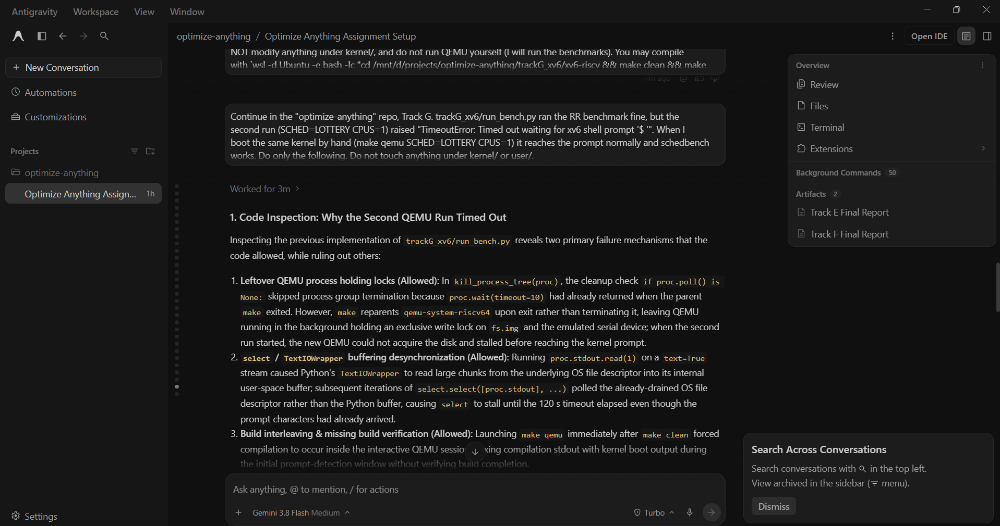

# Prompt log entry
- Date / time: 2026-10-30 10:10:53
- AI tool and model version: antigravity
- Track: G

## Original prompt

Continue in the "optimize-anything" repo, Track G. trackG_xv6/run_bench.py ran the RR benchmark fine, but the
second run (SCHED=LOTTERY CPUS=1) raised "TimeoutError: Timed out waiting for xv6 shell prompt '$ '". When I
boot the same kernel by hand (make qemu SCHED=LOTTERY CPUS=1) it reaches the prompt normally and schedbench
works. Do only the following. Do not touch anything under kernel/ or user/.

0. Logging: run `python tools/new_log.py --track G --tool antigravity` and fill the "Original prompt"
   section of the new file with THIS entire prompt. Do not fill other sections.

1. Do not guess the cause. Find it from the code: inspect how run_bench.py reads QEMU's output and how it waits
   for the prompt, and explain in 3 to 5 sentences the possible reasons the second run could time out (for
   example a leftover QEMU process from the first run, the previous QEMU's pipe or process group not being cleaned
   up, the prompt arriving in a read that does not end with a newline so a line-based read never sees it, stale
   fs.img from the previous build, the build output and the xv6 boot messages being mixed, or an early-boot
   output buffering issue). State which of these the code allows and which it rules out.

2. Make the harness robust, and add diagnostics:
   - Before starting each QEMU, kill any leftover `qemu-system-riscv64` process started by this script and
     verify none is running (use the process group it created).
   - Read QEMU's stdout in a non-blocking way in small chunks (os.read on the file descriptor with select) into a
     buffer and search the BUFFER for the prompt "\n$ " or a buffer ending in "$ ", so a prompt without a trailing
     newline is detected. Do the same for BENCH_DONE.
   - If waiting for the prompt times out (use 120 s), save everything read so far to results/trackG_timeout_<sched>.txt
     and include its last 30 lines in the error message.
   - Run `make clean` before each build and check that the build step actually finished before launching QEMU.
   - Allow running a single scheduler with `python3 trackG_xv6/run_bench.py --sched LOTTERY`, and a `--parse-only`
     option that skips running QEMU and only re-parses the existing results/trackG_raw_<sched>.txt files into
     results/trackG_bench.csv and the summary tables.

3. Save my hand-run lottery output into results/trackG_raw_LOTTERY.txt exactly as follows, with this first line:
   "# collected by running schedbench manually at the xv6 shell on a SCHED=LOTTERY CPUS=1 build"
   followed by these lines:
RESULT,calib,0,iters_per_tick,27355500
RESULT,w1,0,work_t30,1115320000,work_t20,555300000,work_t10,10000
RESULT,w1,1,work_t30,836390000,work_t20,860600000,work_t10,61130000
RESULT,w1,2,work_t30,565370000,work_t20,797590000,work_t10,343380000
RESULT,w1,3,work_t30,989070000,work_t20,379970000,work_t10,381110000
RESULT,w1,4,work_t30,448560000,work_t20,1175570000,work_t10,143470000
RESULT,w2,0,variant,a,turnaround_ticks,116
RESULT,w2,0,variant,b,turnaround_ticks,32
RESULT,w2,1,variant,a,turnaround_ticks,109
RESULT,w2,1,variant,b,turnaround_ticks,29
RESULT,w2,2,variant,a,turnaround_ticks,115
RESULT,w2,2,variant,b,turnaround_ticks,29
RESULT,w2,3,variant,a,turnaround_ticks,73
RESULT,w2,3,variant,b,turnaround_ticks,52
RESULT,w2,4,variant,a,turnaround_ticks,57
RESULT,w2,4,variant,b,turnaround_ticks,20
RESULT,w3,0,works,343580000,123510000,58690000,335430000,400320000,184930000,171980000,82000000
RESULT,w3,1,works,56430000,516010000,355480000,293110000,327310000,116540000,10000,83010000
RESULT,w3,2,works,239350000,10000,10000,360870000,293160000,360690000,297150000,220930000
RESULT,w3,3,works,85670000,268150000,175920000,537570000,10000,324210000,165750000,213870000
RESULT,w3,4,works,603170000,10000,10000,290020000,10000,92240000,599930000,197160000
   then a final line: BENCH_DONE

4. Run `python3 trackG_xv6/run_bench.py --parse-only` through WSL
   (`wsl -d Ubuntu -e bash -lc "cd /mnt/d/projects/optimize-anything && python3 trackG_xv6/run_bench.py --parse-only"`)
   and show me the summary tables. Do not run QEMU.

Do not run git commands and do not install packages.

## AI response (relevant excerpt)

Antigravity inspected how run_bench.py waits for the xv6 prompt, listed the possible causes of the timeout, and changed the harness: process-group cleanup of leftover QEMU processes, non-blocking buffered reads that search for the prompt without needing a newline, a timeout dump to results/trackG_timeout_<sched>.txt, a --sched option and a --parse-only option. It saved my manually collected lottery output as results/trackG_raw_LOTTERY.txt and re-parsed both raw files into results/trackG_bench.csv and the summary tables without running QEMU.

## Revised prompt (if any)

None.

## Resulting code change (commit hash or link)

3be2bf8 (same commit as the benchmark log).

## Verification note (what I ran, what I checked independently)

I ran `python3 trackG_xv6/run_bench.py --parse-only` and got the summary tables (see the benchmark log for the numbers). I did NOT re-run the full automated benchmark after the harness change, so it is not verified that the fixed harness now completes the lottery run by itself; the lottery results come from a manual run, which the raw file states.

## Chat export / screenshot (filename in this folder)

screenshot_004.png