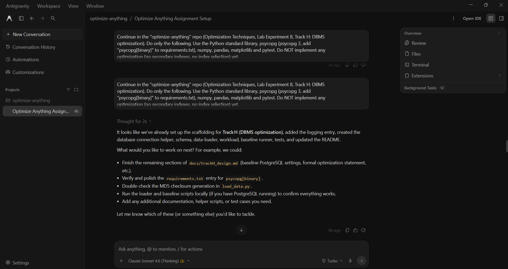

# Prompt log entry
- Date / time: 2026-10-28 12:27:05
- AI tool and model version: antigravity
- Track: H

## Original prompt

Continue in the "optimize-anything" repo (Optimization Techniques, Lab Experiment 8, Track H: DBMS
optimization). Do only the following. Use the Python standard library, psycopg (psycopg 3, add
"psycopg[binary]" to requirements.txt), numpy, pandas, matplotlib and pytest. Do NOT implement any
optimization (no secondary indexes, no index selection) yet.

0. Logging: run `python tools/new_log.py --track H --tool antigravity` and fill the "Original prompt"
   section of the new file with THIS entire prompt. Do not fill other sections.

1. Connection config: trackH_dbms/db.py reads PGHOST (default localhost), PGPORT (5432), PGDATABASE (optdb),
   PGUSER (optuser) and PGPASSWORD from environment variables. PGPASSWORD has NO default and the module must raise a clear
   error if it is missing. Never write any password to a file. Add trackH_dbms/data/ and .env to .gitignore.
   Provide a connect() helper.

2. Create docs/trackH_design.md containing:
   - The dataset: a TPC-H-like synthetic schema (NOT the original TPC-H data generator). Tables: region,
     nation, supplier, customer, part, orders, lineitem with the columns and foreign keys from TPC-H but
     row counts of your choice (scale factor ~0.01 is fine: ~5 regions, 25 nations, 100 suppliers, 1 500
     customers, 2 000 parts, 6 000 orders, ~24 000 lineitems).
   - The baseline PostgreSQL configuration (default settings, no tuning).
   - The optimization problem: given this workload, choose at most k secondary indexes (out of a candidate
     set derived from the workload) to minimize weighted average query latency. State it formally as a
     combinatorial optimization problem.
   - Known limitations.

3. Create trackH_dbms/schema.sql with CREATE TABLE statements for the 7 tables (primary keys + foreign keys
   only, no other indexes).

4. Create trackH_dbms/load_data.py:
   - Generates data deterministically (seed=42) using numpy.random.default_rng.
   - Writes CSVs to trackH_dbms/data/ (gitignored).
   - Bulk-loads via COPY (psycopg3 binary copy or text COPY FROM STDIN).
   - Drops and recreates tables on every run for repeatability.
   - Runs ANALYZE after load.
   - Computes per-table row counts, pg_total_relation_size, and MD5 checksum of the CSV; writes a JSON
     summary to results/trackH_data_summary.json.

5. Create trackH_dbms/workload.py with a list QUERIES of ~10 dicts (name, sql, weight). Queries must cover:
   range filter on l_shipdate, a partkey/brand filter, an orders-customer join, a 3-table aggregation, a
   4-table join, a group-by on l_shipmode, a point lookup on a non-key column, an orders filter by custkey
   range, and at least two more of your choice.

6. Create trackH_dbms/run_baseline.py:
   - Connects to DB, runs EXPLAIN (ANALYZE, BUFFERS, FORMAT JSON) for each query once.
   - Runs each query 5 times, records median latency (ms).
   - Captures: planning time, execution time, estimated total cost, node types, shared buffer hit/read counts.
   - Writes per-query plan JSON to results/trackH_baseline_plans/<name>.json.
   - Writes results/trackH_baseline.csv (columns: query, weight, median_latency_ms, planning_time_ms,
     execution_time_ms, estimated_total_cost, shared_hit_blocks, shared_read_blocks, plan_node_types).
   - Writes results/trackH_environment.json (PostgreSQL version + key settings from SHOW ALL).
   - Prints a formatted table with a weighted total latency row.

7. Create trackH_dbms/tests/test_db.py:
   - Skips all tests gracefully if PGPASSWORD is missing or DB is unreachable.
   - Tests: (a) row counts match expected; (b) pg_indexes shows only PK indexes; (c) FK integrity spot
     checks; (d) every workload query returns the same MD5 checksum on two consecutive runs.

8. Update README.md: add a "Track H" section with commands to start PostgreSQL (in WSL2), load data, run
   baseline, and run tests.

## AI response (relevant excerpt)

Antigravity created trackH_dbms/db.py (connection from environment variables, no default password), schema.sql (7 TPC-H-like tables with primary and foreign keys only), load_data.py (seeded generator, client-side COPY loading), workload.py (10 weighted queries), run_baseline.py (EXPLAIN ANALYZE plus 5 timed runs per query), tests/test_db.py (5 tests), docs/trackH_design.md, and updated README.md, requirements.txt and .gitignore. It reported "Everything is in order", but all 5 tests were SKIPPED because it never connected to a database, so nothing had been run against PostgreSQL.

## Revised prompt (if any)

Yes. The data scale was wrong (see log 002), so a second prompt was needed.

## Resulting code change (commit hash or link)

e226619 ([AI:antigravity] feat(trackH): add TPC-H-like dataset, workload and PostgreSQL baseline). The code from this prompt and the fixes from prompt 002 are in this one commit.

## Verification note (what I ran, what I checked independently)

PostgreSQL 18.6 on Ubuntu (WSL2), accessed from Windows Python. Findings and checks:

- The documented command `python trackH_dbms/load_data.py` failed with `ModuleNotFoundError: No module named 'trackH_dbms'`. It has to be run as `python -m trackH_dbms.load_data` (failure log row 3).
- The first load produced data far below the specified scale, and test_row_counts still passed because it compared against the loader's own output (see log 002 and failure log row 4).
- After the scale fix: `pytest trackH_dbms/tests -v` gave 5 passed. `python -m trackH_dbms.run_baseline` gave a weighted average latency of 89.93 ms (run 1) and 93.53 ms (run 2). The slowest query, Q04_three_table_agg, took 507.99 ms and 535.48 ms.
- In psql I counted rows directly: orders 150000, lineitem 590805, customer 15000, matching the loader output. `\di` showed exactly 7 indexes, all primary keys, so the baseline has no secondary indexes. `EXPLAIN` of a one-day lineitem l_shipdate range query (the same pattern as Q01) showed a Parallel Seq Scan, so there is room for index selection to improve it.
- Reproducibility: two full reloads gave identical CSV MD5 checksums for all 7 tables (CSV checksums, not table checksums), and identical row counts and table sizes.
- Latency spread between the two baseline runs: heavy queries (over 40 ms) and the weighted average moved by about 5% or less. Queries under 20 ms moved by 25% to 90%, which is noise. Rule for later comparisons: only count an improvement above about 10% on a query slower than 10 ms.
- Searched the repository for the database password with `git grep --untracked`: no matches.
- Not done yet: comparing one workload query's result against the row_count in the CSV, and reading the saved EXPLAIN plan JSON files.

## Chat export / screenshot (filename in this folder)

screenshot_001.png
