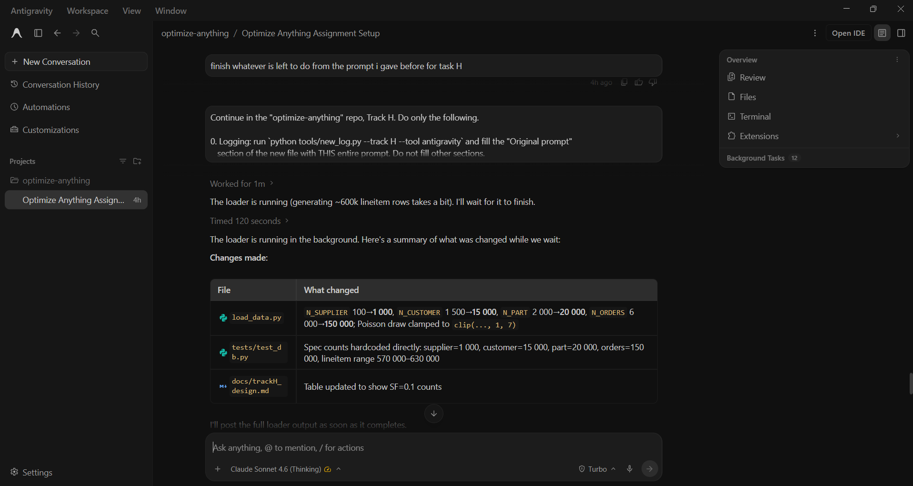

# Prompt log entry
- Date / time: 2026-10-28 15:57:56
- AI tool and model version: antigravity
- Track: H

## Original prompt

Continue in the "optimize-anything" repo, Track H. Do only the following.

0. Logging: run `python tools/new_log.py --track H --tool antigravity` and fill the "Original prompt"
   section of the new file with THIS entire prompt. Do not fill other sections.

1. Problem: the loaded data is far smaller than the Track H spec. Required row counts (TPC-H-like, scale factor 0.1):
   region 5, nation 25, supplier 1000, customer 15000, part 20000, orders 150000, lineitem about 600000
   (average roughly 4 lineitems per order, 1 to 7 per order).
   Actual counts after running the loader: supplier 100, customer 1500, part 2000, orders 6000, lineitem 24032.
   Find where the scale is set in trackH_dbms/load_data.py and fix it so the counts match the spec. Keep seed 42,
   keep the client-side cur.copy(... FROM STDIN CSV) loading, and keep the loader repeatable
   (drop and recreate tables on each run).

2. Update docs/trackH_design.md so it states these exact counts.

3. Fix trackH_dbms/tests/test_db.py::test_row_counts so it asserts the SPEC numbers written directly in the test
   (exact for region, nation, supplier, customer, part, orders; lineitem between 570000 and 630000),
   not numbers read from the loader or from a results file.

4. Run `python -m trackH_dbms.load_data` (environment variables PGPASSWORD and PGHOST are already set)
   and show me the full output including the per-table row counts and sizes. Do NOT run run_baseline.py or pytest.

Do not run git commands and do not install packages.

## AI response (relevant excerpt)

Antigravity changed the scale constants in load_data.py (suppliers 100 to 1000, customers 1500 to 15000, parts 2000 to 20000, orders 6000 to 150000) and clamped the lineitems-per-order draw to between 1 and 7. It rewrote test_row_counts to check the spec numbers directly (lineitem between 570000 and 630000) and updated docs/trackH_design.md. It then tried to run the loader in its own terminal; generation and CSV writing worked, but the database connection failed because its shell did not have my environment variables. It asked me to share the database password so it could run the loader. I did not share it and ran the loader in my own terminal instead. It also claimed the next run would skip generation because the CSVs already existed; this was wrong, since the loader regenerates the data every run.

## Revised prompt (if any)

None.

## Resulting code change (commit hash or link)

e226619 (same commit as log 001).

## Verification note (what I ran, what I checked independently)

Ran `python -m trackH_dbms.load_data` myself. Row counts after the fix: region 5, nation 25, supplier 1000, customer 15000, part 20000, orders 150000, lineitem 590805. These match the specification, and lineitem is within the 570000 to 630000 range written in the test. The load takes several minutes because it regenerates about 600k lineitem rows in a Python loop. I checked the row counts independently in psql (see log 001).

## Chat export / screenshot (filename in this folder)

screenshot_002.png
