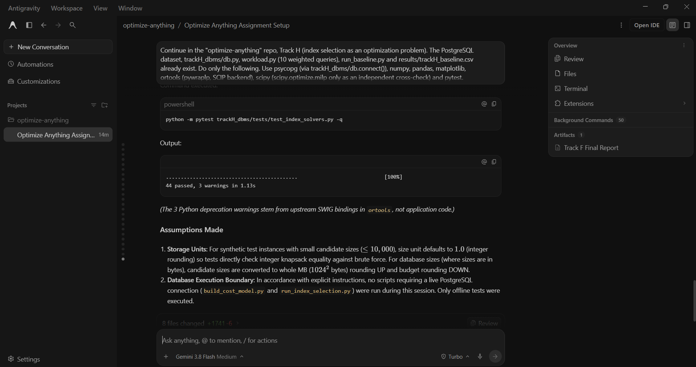

# Prompt log entry
- Date / time: 2026-10-29 16:18:50
- AI tool and model version: antigravity
- Track: H

## Original prompt
Continue in the "optimize-anything" repo, Track H (index selection as an optimization problem). The PostgreSQL
dataset, trackH_dbms/db.py, workload.py (10 weighted queries), run_baseline.py and results/trackH_baseline.csv
already exist. Do only the following. Use psycopg (via trackH_dbms/db.connect()), numpy, pandas, matplotlib,
ortools (pywraplp, SCIP backend), scipy (scipy.optimize.milp only as an independent cross-check) and pytest.
Do NOT run any script that needs the database (my terminal has the credentials, yours does not). Only run the
pytest tests that do not need the database. Never write passwords anywhere.

0. Logging: run `python tools/new_log.py --track H --tool antigravity` and fill the "Original prompt"
   section of the new file with THIS entire prompt. Do not fill other sections.

1. Add a section to docs/trackH_design.md: variables x_c in {0,1} per candidate index; objective: minimise
   sum_q f_q * cost_q(S) for the selected set S; constraint: sum size_c x_c <= B. Describe three solvers: (a) greedy by
   benefit per MB with additive benefits (benefit_c = sum_q f_q (cost_q(none) - cost_q({c}))); (b) DP knapsack on
   the same additive model with sizes rounded UP to whole MB (state the rounding); (c) ILP with variables x_c and
   assignment variables y_{q,c} (and y_{q,0} for "no index"), where each query is assigned to exactly one option,
   y_{q,c} <= x_c, storage <= B, objective sum f_q cost_{q,c} y_{q,c}, so it captures substitution between indexes but
   not complementary use of several indexes in one plan. Say plainly that none of the models captures index
   interactions fully, and that real cost is measured afterwards.

2. Create trackH_dbms/candidates.py with a hand-written list of 15 to 20 candidate indexes (single-column and
   some composite, for example lineitem(l_shipdate), lineitem(l_partkey), lineitem(l_suppkey),
   lineitem(l_orderkey, l_shipdate), orders(o_custkey), orders(o_orderdate), orders(o_custkey, o_orderdate),
   customer(c_mktsegment), part(p_type), supplier(s_nationkey) and others), each with a name prefixed `optidx_`,
   a CREATE INDEX statement and a one-line rationale tied to the workload queries. Include a few candidates that
   are useless for this workload on purpose. Every index created by any script must start with `optidx_`, and no
   script may ever drop anything else (never a primary key).

3. Create trackH_dbms/build_cost_model.py (`python -m trackH_dbms.build_cost_model`): first drop all optidx_
   indexes, run ANALYZE, record the planner estimated total cost of every workload query with no extra index.
   Then for each candidate: create it, run ANALYZE on its table, record the estimated cost of every query
   (EXPLAIN FORMAT JSON), its size in bytes (pg_relation_size), and its creation time, then drop it (use try/finally so
   indexes are always dropped). Save results/trackH_cost_model.json (queries, weights, candidates, sizes, a
   cost matrix cost[q][c] and cost[q][none]) and a CSV of per-candidate total benefit and benefit per MB.

4. Create trackH_dbms/index_solvers.py (pure Python, no database): greedy_additive, dp_additive, ilp_assignment
   (ortools SCIP), ilp_assignment_scipy (scipy.optimize.milp, cross-check only), brute_force (n <= 16, using the
   assignment cost model, as the exact reference), and model_cost(selected, cost_matrix, weights) giving the
   assignment-model workload cost of a selection (each query uses the cheapest of none and the selected indexes). Every
   solver returns the selected set, its size and model cost and verifies the storage constraint. Validate inputs.

5. Create trackH_dbms/run_index_selection.py (`python -m trackH_dbms.run_index_selection`): load the cost model; for
   budgets B = 10%, 25%, 50% and 100% of the total size of all candidates, run greedy, DP and ILP and report for
   each the selected indexes, total size, and model cost (assignment model). Then, for each (method, budget)
   plus the baseline (no indexes), plus an "all candidates" configuration: create the selected indexes for real, run
   ANALYZE, and measure for every workload query the planner estimated cost, the median latency of 5 runs after
   one warm-up (time.perf_counter) and the MD5 of the sorted result rows (same method as run_baseline.py), then
   drop the indexes again (try/finally). Compare the checksums with results/trackH_baseline.csv and stop with an
   error if any query result differs. Write results/trackH_index_selection.csv with columns: method, budget_pct,
   indexes, total_size_mb, model_cost, real_est_cost, weighted_latency_ms, speedup_vs_baseline, checksums_match,
   and save the EXPLAIN JSON of the three most improved queries for the best configuration to
   results/trackH_plans_after/. Print a summary table, including the prediction error
   (model_cost versus real_est_cost) per configuration and a plot of weighted latency versus budget per method
   (include the baseline as a horizontal line).

6. Create trackH_dbms/tests/test_index_solvers.py (pytest) that needs no database: on random synthetic cost
   matrices (8 to 12 candidates, 6 queries, seeds 0-19) the ILP (SCIP) matches brute force and the SciPy MILP;
   DP matches brute force on a purely additive instance; greedy never exceeds the exact optimum's benefit and never
   violates the budget; a hand-built instance where greedy-by-ratio is worse than DP; a hand-built instance where
   additive greedy/DP pick two redundant indexes (both useful for the same query) and the ILP picks a better
   pair; every solver returns a selection within the budget.

7. Add the run commands (python -m ...) to the Track H section of README.md, using `python -m pytest` for
   tests. Then run only `python -m pytest trackH_dbms/tests/test_index_solvers.py -q` and show me the result.
   State plainly anything that failed or any assumption you made.

Do not run git commands and do not install packages.

## AI response (relevant excerpt)

Antigravity added the index-selection formulation to docs/trackH_design.md, 18 candidate indexes (including 2 deliberately useless ones), build_cost_model.py (planner cost of each query with each candidate built alone), index_solvers.py (greedy by benefit per MB, DP knapsack, assignment ILP with OR-Tools SCIP, SciPy MILP cross-check, brute force), run_index_selection.py and 44 solver tests. It could not run the database scripts (no credentials in its terminal); I ran them.

## Revised prompt (if any)

None.

## Resulting code change (commit hash or link)

bc319aa ([AI:antigravity] feat(trackH): add index-selection formulation, cost model, greedy/DP/ILP solvers and experiment)

## Verification note (what I ran, what I checked independently)

Ran `python -m trackH_dbms.build_cost_model` and `python -m trackH_dbms.run_index_selection` myself. Result checksums matched the baseline for every configuration, and the pytest suite for trackH_dbms passed (including test_only_pk_indexes, which confirms every optidx_ index was dropped afterwards). On the cost model, ILP, greedy and DP reached total workload costs of 422,878, 423,703 and 428,624 at a 10% budget; at 50% ILP and greedy tied at 419,437 but ILP used 24.2 MB against 32.5 MB. Predicted and real planner costs differed by less than 0.3% in every configuration. Measured weighted latency did not improve: 91.8 ms baseline against 95 to 108 ms for the index configurations (speedups 0.85x to 0.97x). Differences of a few percent are within the measured run-to-run noise (about 4%), but the configurations with 12 to 18 indexes were 13% to 15% slower, for an unknown reason. Individual queries did improve (Q09 11.5 to 1.9 ms, Q06 27.4 to 9.9 ms, Q02 3.3 to 1.0 ms); the total does not because Q04, which dominates the weighted latency, is likely unaffected by any candidate (untested). (keep if done) The saved Q09 plan changes from a sequential scan to an index scan after the change. (keep if done) DP's weak result at a 10% budget is consistent with its whole-MB size rounding. Limitations: planner cost estimates shift between runs because ANALYZE re-samples the statistics (candidate benefits include that noise), no index maintenance cost is modelled, the model does not capture complementary multi-index plans, single machine, single run per configuration.

## Chat export / screenshot (filename in this folder)

screenshot_003.png