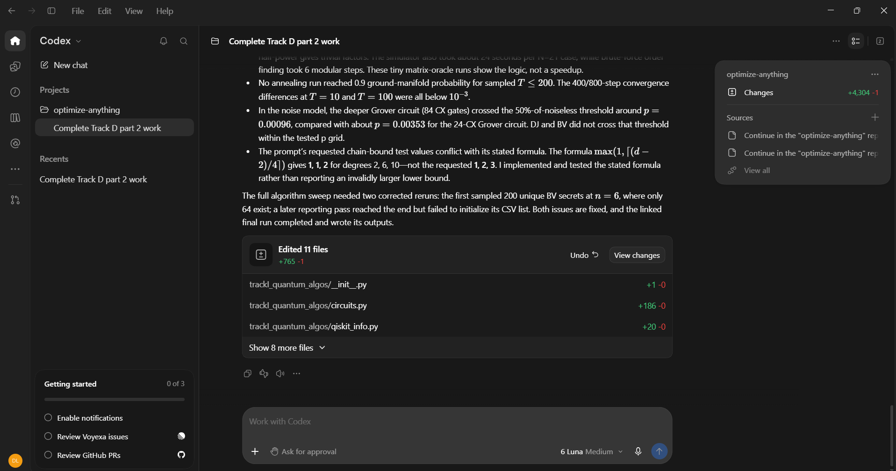

# Prompt log entry
- Date / time: 2026-11-05 12:11:18
- AI tool and model version: codex
- Track: I

## Original prompt

Continue in the "optimize-anything" repo, Track I part 1 of 2 (quantum algorithms on simulators). Do only the
following. Use numpy, scipy, qiskit (version 2.x is installed) and qiskit-aer, pandas, matplotlib and pytest. Make
trackI_quantum_algos a package (add __init__.py) so that `python -m trackI_quantum_algos.<name>` works. Do not change
existing files except README.md. The installed Qiskit API changed a lot between versions: do NOT guess call signatures.
Before using any Qiskit function, inspect the installed version (inspect.signature or help) and print qiskit.__version__
and qiskit_aer.__version__ at the start of each experiment. Library implementations (qiskit.circuit.library) may be used
ONLY to cross-check; every algorithm circuit below must be written by hand from basic gates (h, x, z, cx, cp, p, ry, swap,
mcx or a hand-built multi-controlled Z), so that I can explain it without the AI tool.

0. Logging: run `python tools/new_log.py --track I --tool <the name of the tool you are, in lower case>` and fill the
   "Original prompt" section of the new file with THIS entire prompt. Do not fill other sections.

1. Create docs/trackI_design.md (short, no results): for each algorithm the problem, the circuit, the number of oracle
   queries and the classical comparison: Deutsch-Jozsa (1 query against 2^(n-1) + 1 classical queries deterministically),
   Bernstein-Vazirani (1 query against n), Grover (about (pi/4) sqrt(N) queries against N/2 on average for one marked
   item among N), QFT (O(n^2) gates; its output amplitudes cannot be read out directly), quantum phase estimation (the
   register of t qubits gives phi to about t bits), Shor (order finding by phase estimation of the modular
   multiplication a*x mod N, continued fractions, and the classical post-processing), and quantum annealing (the
   Hamiltonian H(s) = -(1 - s) sum X_i + s H_P and the adiabatic condition: the required time grows like 1/gap^2). State
   that all results are SIMULATED on a classical computer, that no real quantum hardware was used, and that the
   simulations cost time exponential in the number of qubits. Define the labels MEASURED (a timing or count taken in this
   repo), SIMULATED (a quantum computation run on a classical simulator or noise model) and THEORETICAL (a formula).

2. Create trackI_quantum_algos/circuits.py with these hand-written functions, each returning a QuantumCircuit:
   - dj_circuit(n, oracle): n input qubits plus one ancilla; oracle is a callable that appends the oracle to the circuit
     for either a constant function or a balanced function (provide helpers constant_oracle(value) and
     balanced_oracle_from_truth_table(table) that implement f(x) by multi-controlled X gates on the ancilla).
   - bv_circuit(n, secret) using CNOT gates from the secret bits to the ancilla.
   - grover_circuit(n, marked, k): the uniform superposition, k iterations of the oracle (phase flip of the marked
     basis state implemented with X gates and a multi-controlled Z that you build by hand) and the diffuser
     (H, X, multi-controlled Z, X, H), plus an optional measure_all flag. Document the bit-order convention.
   - qft_circuit(n) with Hadamards, controlled phase gates cp(pi / 2^k) and the final swaps, plus inverse_qft_circuit(n).
   - qpe_circuit(t, phi): t counting qubits and one eigenstate qubit prepared in |1> for U = P(2 pi phi), using controlled
     powers of U (as a single controlled phase rotation per counting qubit with the angle 2 pi phi 2^j), then your inverse
     QFT.
   - shor_order_circuit(a, N, t): t counting qubits and ceil(log2 N) work qubits starting in |1>; the controlled
     multiplication by a^(2^j) mod N is a permutation unitary built from classical modular arithmetic (a matrix on the work
     register, permuting x to (a^(2^j) x) mod N and leaving values x >= N fixed) added as a controlled UnitaryGate; then
     the inverse QFT. State in the docstring that this oracle is a MATRIX-based simulation of modular multiplication and not a
     gate-level decomposition.
   Validate inputs. Also provide classical_order(a, N) (brute force), continued_fraction_order(measurement, t, N, a) (the
   post-processing to a candidate order using fractions.Fraction.limit_denominator) and factors_from_order(a, r, N).

3. Create trackI_quantum_algos/exp1_algorithms.py (`python -m trackI_quantum_algos.exp1_algorithms`). Use the exact
   statevector (qiskit.quantum_info.Statevector or the Aer statevector simulator) for probabilities, and sampling with
   shots only where stated. Parts:
   a) Deutsch-Jozsa for n = 2 to 6: all constant functions and 200 random balanced functions per n (for n = 2 and 3
      enumerate ALL balanced functions); the probability of measuring |0...0> must be 1 for constant and 0 for balanced
      (stop with an error otherwise). Report the number of oracle queries used by the quantum circuit (1) and the classical
      deterministic worst case 2^(n-1) + 1 (THEORETICAL), and the circuit gate counts after decomposing to
      {h, x, cx, p} with transpile (the Qiskit function transpile with a basis gate list; inspect its signature).
   b) Bernstein-Vazirani for n = 2 to 8: all secrets for n <= 5 and 200 random secrets above that: the secret is recovered
      with probability 1 (stop with an error otherwise); 1 quantum query against n classical queries.
   c) Grover for n = 2 to 10 qubits: success probability against the number of iterations k (0 to 2 * optimal) for a random
      marked item; compare with sin^2((2k + 1) theta), theta = arcsin(1 / sqrt(N)) (maximum absolute difference below 1e-9,
      otherwise stop with an error); report the optimal k = floor(pi / 4 sqrt(N)) and the success probability there; show the
      overshoot (success falls again when k is too large); cross-check one case against qiskit's GroverOperator (inspect
      its API first) and report agreement of probabilities. Also report 3 marked items out of N = 16.
   d) QFT for n = 1 to 6: the operator of your circuit equals the discrete Fourier transform matrix
      F[j, k] = exp(2 pi i j k / N) / sqrt(N) up to the bit-ordering convention you document (maximum absolute difference below
      1e-10 after applying the documented swap convention; stop with an error otherwise), and your inverse equals the conjugate
      transpose; report gate counts (about n(n+1)/2 controlled phases and Hadamards plus swaps) against the classical FFT
      operation count N log2 N (THEORETICAL), and state clearly that the QFT's output amplitudes cannot be read out in one
      run so this is not a speedup for computing a Fourier transform.
   e) Phase estimation: for t = 3 to 8 counting qubits and (i) phi = 3/8 (exactly representable with t = 3) and (ii) phi = 0.3
      (not representable), report the probability distribution over the t-bit estimates, the most likely estimate, the
      probability of the nearest t-bit value and the error |phi_hat - phi|; exact phase must give probability 1.
   f) Shor on a simulator: N = 15 with a in {2, 4, 7, 8, 11, 13} (a = 4, 11 have order 2; others order 4) and N = 21 with
      a = 2 and a = 5; t = 2 ceil(log2 N) counting qubits. For each case compute the exact output distribution, report the
      probability that a single run yields a measurement that the continued-fraction step turns into the correct order, and
      the probability that the full procedure (up to 3 runs) returns a non-trivial factor pair. Compare with classical trial
      division of N and brute-force classical_order. Report the qubit count and the simulation time (MEASURED, and note that
      it grows exponentially). State plainly that this shows the algorithm's logic on tiny numbers and no speedup.
   Save results/trackI_algorithms.csv and these plots: Grover success against k for several n, the QPE distribution for phi
   = 0.3, and the Shor measurement distribution for a = 7, N = 15. Print every table, with a label (MEASURED, SIMULATED or
   THEORETICAL) on every row.

4. Create trackI_quantum_algos/exp2_annealing.py (`python -m trackI_quantum_algos.exp2_annealing`): read
   results/trackB_maxcut_instances.json (inspect its structure first), take the n = 10 instances (up to 5), build the Ising
   cost with trackB_discrete.qubo (maxcut_to_qubo and qubo_to_ising; the energies must be minimised by the maximum cut:
   verify that the minimum energy equals minus the optimal cut value stored in the JSON, otherwise stop with an error).
   Simulate quantum annealing exactly with the dense Hamiltonian H(s) = -(1 - s) sum_i X_i + s * E_scaled, where E_scaled is
   the diagonal Ising energy divided by its maximum absolute value, s = t / T:
   a) The spectral gap along s in [0, 1] (200 points). Max-Cut has a global spin-flip symmetry (the operator P = product of
      X_i commutes with H(s) and the initial state has P = +1), so the relevant gap is between the two lowest eigenvalues in
      the P = +1 sector only: build the sector with the projector (I + P) / 2 or by symmetrising the basis, and explain this in
      the code. Report the minimum gap and where it occurs for each instance. Do NOT report the gap between the two lowest
      eigenvalues of the full Hamiltonian as the relevant gap (it closes to zero at s = 1 because the ground state is doubly
      degenerate).
   b) Time evolution: integrate the Schrodinger equation i d psi / dt = H(t / T) psi with a piecewise-constant approximation
      (at least 400 steps, each step exact with scipy.sparse.linalg.expm_multiply or a dense eigendecomposition) for
      T in {1, 2, 5, 10, 20, 50, 100, 200}; report the probability of ending in the ground-state manifold (both degenerate
      optimal assignments) and check convergence by doubling the number of steps for two T values (the probabilities must
      agree within 1e-3). Report for each instance the smallest T with success probability at least 0.9 and compare its order
      of magnitude with 1 / gap_min^2 (THEORETICAL scaling, not a proof).
   c) Embedding limits (THEORETICAL, derived by counting, no hardware): on the Chimera topology every qubit has at most 6
      couplers, so a chain of L qubits that is a path has at most 6L - 2(L - 1) = 4L + 2 external couplers; a logical variable
      with d neighbours in the problem graph therefore needs a chain of at least ceil((d - 2) / 4) qubits (and at least 1).
      For the 15 Track B instances (n = 10, 12, 14), compute the lower bound on the physical qubits (sum of the chain
      lengths), and the same bound for Pegasus using a maximum of 15 couplers per qubit (chain of L qubits has at most
      15L - 2(L - 1) external couplers). State that these are lower bounds from counting only, that real embeddings need more,
      and that no annealing hardware was used. Also print the logical degree distribution.
   Save results/trackI_annealing.csv and plots: the gap against s for one instance, and success probability against T on a
   log axis for each instance. Label every row SIMULATED or THEORETICAL.

5. Create trackI_quantum_algos/exp3_noise.py (`python -m trackI_quantum_algos.exp3_noise`): use qiskit_aer.AerSimulator with
   a NoiseModel (inspect its API first) containing depolarizing error on single-qubit gates with probability p and on
   two-qubit gates with probability 10 p, p in {0, 1e-4, 1e-3, 3e-3, 1e-2, 2e-2}. Transpile each circuit to the basis
   ['cx', 'rz', 'sx', 'x'] (optimization_level 1) and report the transpiled depth and the cx count. Circuits: Deutsch-Jozsa
   with n = 3 and a balanced oracle, Bernstein-Vazirani with n = 4, Grover with n = 3 (k = 2) and n = 4 (k = 3), and QPE with
   t = 4 for phi = 3/8. For each, 4096 shots and 5 independent repetitions per p (mean and standard deviation of the success
   probability: the probability of the correct output). Show how deeper circuits (more cx gates) lose success faster and
   report the p at which the success probability of each circuit falls below 50% of its noiseless value (interpolate and
   say so). State at the top and in the output that this is a simulated noise MODEL (depolarizing errors only, no readout
   error, no relaxation) and not a hardware measurement, and that no real quantum hardware was used. Save
   results/trackI_noise.csv and a plot.

6. Create trackI_quantum_algos/tests/test_algos.py (pytest, fast, under 1 minute): DJ returns |0...0> with probability 1 for
   constant and probability 0 for ALL balanced functions at n = 3; BV recovers every secret at n = 4; Grover success
   probability equals sin^2((2k + 1) theta) for 5 (n, k) pairs within 1e-9, and for n = 3 the optimal k = 2 gives about 0.945;
   the QFT operator equals the DFT matrix (with the documented convention) for n = 1 to 4 within 1e-10; QPE with phi = 3/8 and
   t = 3 returns the estimate 3 with probability 1 within 1e-9; classical_order(7, 15) = 4 and continued_fraction_order on the
   hand-made measurement 64 (t = 8, N = 15, a = 7, phase 1/4) returns 4, and factors_from_order(7, 4, 15) = (3, 5);
   the minimum Ising energy of a hand-built 3-node triangle equals the minus maximum cut; the chain-length lower bound is 1 for
   degree 2, 2 for degree 6 and 3 for degree 10; the annealing sector gap for a 2-spin hand example agrees with its analytic
   value.

7. Add the run commands (python -m ...) to a "Track I" section of README.md, using `python -m pytest` for tests. Before running
   the experiments, estimate and print the runtime of each; if one exceeds 10 minutes reduce the sweep and say what was
   reduced. Print progress with flush=True and offer a --quick option. Then run `python -m pytest trackI_quantum_algos -q`
   and the three experiments and show me the full test output and every printed table. State plainly anything that failed,
   any check that did not pass, any case where a simulated algorithm gives no advantage, and anything surprising. Do not
   explain anything away without evidence.

Do not run git commands and do not install packages.

## AI response (relevant excerpt)

Codex added the trackI_quantum_algos package: hand-written circuits (Deutsch-Jozsa, Bernstein-Vazirani, Grover, QFT and inverse, quantum phase estimation, a matrix-oracle Shor order-finding circuit with continued-fraction post-processing), three experiments (algorithm sweeps, exact quantum annealing simulation with embedding lower bounds, a simulated depolarizing noise model), 9 tests, a design note and README commands. It inspected the installed Qiskit 2.6.1 and Aer 0.18.2 APIs before using them. All results are simulated; no quantum hardware was used.

## Revised prompt (if any)

None.

## Resulting code change (commit hash or link)

<HASH> ([AI:codex] feat(trackI): add hand-written quantum algorithms, annealing, embedding bounds and noise experiments (part 1))

## Verification note (what I ran, what I checked independently)

Re-ran `python -m pytest trackI_quantum_algos -q`: 9 passed. Reported results: the QFT matrix equals the DFT matrix up to about 5e-15 for up to 6 qubits; phase estimation recovers an exactly representable phase with probability 1; Grover success follows sin^2((2k+1)theta) and agrees with Qiskit's GroverOperator to 12 digits (n = 4, k = 1: 0.472656); Shor order finding on N = 15 and N = 21 works with a matrix-based modular multiplication oracle, N = 21 with a = 5 has zero success probability because its order is 6 and 5^3 = -1 (mod 21), and the simulation of N = 21 took about 24 s per case against about 0.1 to 0.3 s for N = 15 (measured; the cost of simulation grows exponentially). Annealing on four n = 10 Max-Cut instances: the minimum energy matches the optimal cut from the Track B file; no instance reached 0.9 ground-state probability for T up to 200 (success probability at T = 200 between 0.04 and 0.09), and the 400-versus-800-step convergence checks agree within 1e-5. The reported symmetric-sector gap is 0 at s = 1 for the two instances with several optimal cuts (6 and 4 optimal assignments) and 0.0213 and 0.0097 for the two with one complementary pair; I judged the zero gaps to come from genuine degeneracy, but did not verify the gap computation independently. The noise model (depolarizing, no readout error or relaxation): the deeper Grover circuit (84 cx gates) fell below 50% of its noiseless success probability near p = 0.00096, the shallower one (24 cx) near p = 0.0035, and Deutsch-Jozsa and Bernstein-Vazirani did not cross within the tested range. The chain-length lower bound uses the formula max(1, ceil((d - 2) / 4)); my prompt's expected test values were inconsistent with this formula (failure log row 21). Limitations: all simulated; the embedding numbers are lower bounds from counting only; Shor uses a matrix oracle, not a gate-level decomposition; no hardware access.

## Chat export / screenshot (filename in this folder)

screenshot_001.png
