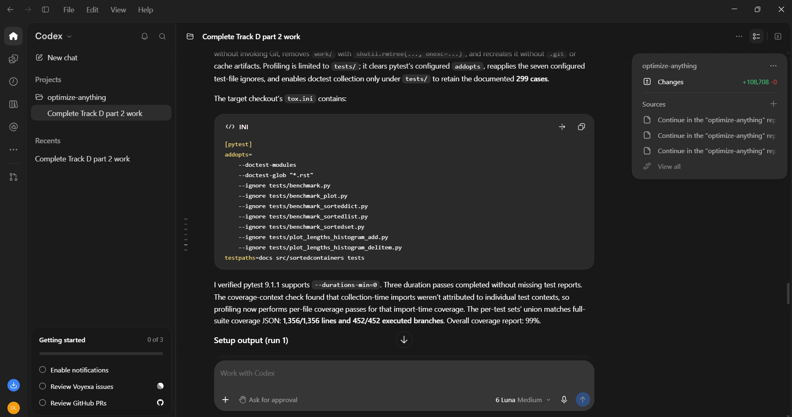

# Prompt log entry
- Date / time: 2026-11-06 01:33:19
- AI tool and model version: codex
- Track: J

## Original prompt

Continue in the "optimize-anything" repo, Track J (software-engineering optimization: test-suite minimization of an open-source
project). The target is the open-source project grantjenks/python-sortedcontainers (Apache 2.0), pinned to commit 3ac3586
(about 2,900 lines of source under src/sortedcontainers, 299 tests, 99% line coverage, tests run in about 4 s without and about 25
s with coverage on this machine). Do only the following. Use numpy, scipy (scipy.optimize.milp only as a cross-check), ortools
(pywraplp, SCIP backend), pandas, matplotlib, pytest, and the packages `coverage` (already installed) and `ast`. Do not install
packages. Make trackJ_software_eng a package (add __init__.py) so that `python -m trackJ_software_eng.<name>` works. The
target code must NEVER be modified in place and must not be committed to this repo.

0. Logging: run `python tools/new_log.py --track J --tool <the name of the tool you are, in lower case>` and fill the "Original
   prompt" section of the new file with THIS entire prompt. Do not fill other sections.

1. Create trackJ_software_eng/setup_target.py: clones https://github.com/grantjenks/python-sortedcontainers.git into
   trackJ_software_eng/target/ if it does not exist, checks out commit 3ac3586, verifies `git rev-parse --short HEAD` equals
   3ac3586 (stop with an error otherwise) and prints the commit, the source line count of src/sortedcontainers and the number of
   tests. Add trackJ_software_eng/target/ and trackJ_software_eng/work/ to .gitignore. All later scripts must use a COPY of the
   target in trackJ_software_eng/work/ (created with shutil.copytree, tests included) for anything that changes files. All
   subprocess calls must use the current Python (sys.executable), set PYTHONPATH to the source directory of the copy being tested,
   and use a timeout.

2. Create docs/trackJ_design.md (short, no results): the problem (a test suite takes a long time in CI; choose a subset); the
   formulation: variables x_t in {0, 1} for each test t, objective minimise sum_t c_t x_t where c_t is the measured runtime of test
   t, constraints: for every line and every branch e covered by the FULL suite, sum_{t covers e} x_t >= 1 (set cover, NP-hard; greedy
   gives a ln(n) + 1 approximation for the weighted problem; the ILP gives the optimum); the methods (greedy by newly covered
   elements per second, the ILP with OR-Tools SCIP cross-checked with scipy.optimize.milp, and the baselines: the full suite, a
   random subset of the same size as the ILP subset (20 draws), and the first K tests in file order with the same K); the measure
   of the cost in correctness (mutation score on hand-generated mutants, the fraction of mutants killed by the full suite that the
   subset still kills); the profile of the baseline (slowest tests and the share of total time by test file); and the limitations
   (coverage is not fault detection, mutants are synthetic, equivalent mutants, 3 timing repetitions on one machine).

3. Create trackJ_software_eng/profile_tests.py (`python -m trackJ_software_eng.profile_tests`): in the copy of the target, run
   every test (use `pytest --collect-only -q` to list the test ids; for parametrized tests keep each id as a unit) ALONE under
   coverage with branch coverage and dynamic contexts disabled, 3 repetitions, record the median wall time of the test run
   (subtract nothing; report the measured time of the pytest call per test using `--durations=0` or a plugin-free approach: run
   `python -m coverage run --branch -m pytest <id> -q` and parse the elapsed time of the call from `--durations`, or time the whole
   process and also record the process start-up overhead separately by running an empty test, and say which you use), and save
   for each test the set of covered lines and branches from `coverage json`. To keep the runtime reasonable (a pytest process start
   per test costs about 1 s), run tests in batches only if you can still attribute coverage to each test; otherwise use
   coverage's dynamic context feature (`--context=test` with `[run] dynamic_context = test_function`) in ONE run of the full suite
   to get per-test coverage, and measure each test's runtime in a second pass with `pytest --durations=0 -q` (3 repetitions).
   Print the estimated runtime first and choose the cheaper valid approach. Save results/trackJ_profile.csv (test id, file, median
   runtime, number of covered lines, number of covered branches) and results/trackJ_coverage_sets.json (test id to the list of
   covered line and branch ids). Print the 10 slowest tests, the share of runtime by test file, the number of tests that cover
   nothing unique and the total number of line and branch elements in the full suite's coverage.

4. Create trackJ_software_eng/minimize.py (`python -m trackJ_software_eng.minimize`): read the profile and coverage sets, build the
   set-cover instance for the elements covered by the full suite, and solve: greedy (weighted), ILP (OR-Tools SCIP, report whether
   it proved optimality and the solve time), the SciPy milp cross-check (the objective values must agree within 1e-6; stop with an
   error otherwise), the baselines described in item 2 (random 20 draws with the same size as the ILP subset; first K tests with
   the same K; also a "fastest tests first until covered" heuristic). For every method report the number of tests, total measured
   runtime (sum of c_t), and the coverage of lines and branches it achieves according to the recorded sets (the covering methods
   must reach 100% of the full suite's elements; the baselines usually will not: report their coverage). Also report the
   same table with coverage as the objective cost c_t = 1 (the minimum NUMBER of tests). Save the selected subsets to
   results/trackJ_subsets.json and the table to results/trackJ_minimization.csv. Add a run of each covering subset on the real
   suite: all selected tests must pass, and the coverage measured by actually running the subset with
   `coverage run --branch -m pytest <ids>` must equal the full suite's line and branch coverage (stop with an error and print the
   difference otherwise). Measure the wall time of the full suite and of each subset, with and without coverage, 3 repetitions
   each, and report the speedup with its spread.

5. Create trackJ_software_eng/mutants.py (`python -m trackJ_software_eng.mutants`): generate mutants of the three large modules
   (sortedlist.py, sortedset.py, sorteddict.py) with a hand-written ast.NodeTransformer: replace a comparison operator (< with <=,
   == with !=, and so on), replace + with - and the reverse, change an integer constant by one, replace `and` with `or`, and remove
   an `if` branch (replace its test by False). Each mutant is one single change, applied to a copy of the target (never the
   original). Sample 60 mutants with a fixed seed spread over the three files (list them in results/trackJ_mutants.csv with file,
   line, operator, description). Run the FULL suite against each mutant with a timeout of 120 s (a timeout counts as killed and
   is marked as timeout), record whether the suite killed it, and which tests failed first. Mutants that the full suite does not
   kill are treated as equivalent or undetected and excluded from the denominator of the subset comparisons; report their number.
   Then run every subset (ILP, greedy, the baselines) against the mutants that the full suite killed, and report each subset's
   mutation score (the fraction of those mutants it kills), with the number of mutants. To keep the runtime low, run the subset
   with `pytest -x` and run only the tests in the subset. Print the estimated runtime first; if it exceeds 25 minutes, reduce the
   mutant count to 40 and say so. Save results/trackJ_mutation.csv.

6. Create trackJ_software_eng/tests/test_j.py (pytest, fast, under 1 minute and not requiring the clone if it is absent: skip with a
   message): the set cover solvers on a hand-built instance with a known optimum (for example 6 elements and 4 sets where greedy
   is not optimal and the ILP is); greedy covers everything on 10 random instances; the ILP never costs more than greedy and equals
   the SciPy result on the random instances; the sum of the selected costs equals the reported cost; the AST mutator changes exactly
   one node and produces code that compiles; the mutation score of the full suite on the mutants it killed is 1.0.

7. Add the run commands (python -m ...) to a "Track J" section of README.md, using `python -m pytest` for tests, plus a short
   section in docs/trackJ_design.md after the run that states the measured gain AND its cost in correctness, and the limits of this
   experiment. Then run `python -m pytest trackJ_software_eng -q` and the scripts in order (setup_target, profile_tests, minimize,
   mutants) and show me the full test output and every printed table. State plainly anything that failed, any subset that did not
   keep full coverage, any mutant the subset missed, any speedup that is within the timing spread, and anything surprising. Do not
   explain anything away without evidence.

Do not run git commands and do not install packages.

## AI response (relevant excerpt)

The tool changed the Track J scripts as requested (setup_target.py, profile_tests.py, minimize.py, setcover.py, mutator.py and tests, as described in the Original prompt) and reported its results. Several of its scripts failed on Windows or on the real data before working; see failure log row 23.

## Revised prompt (if any)

Yes, follow-up prompts fixed the problems found (Windows deletion, doctest collection, zero-cost tests).

## Resulting code change (commit hash or link)

44fa590 ([AI:Codex] feat(trackJ): add test-suite minimization scripts)

## Verification note (what I ran, what I checked independently)

I ran the scripts myself in my virtual environment: `python -m pytest trackJ_software_eng/tests -q` (5 passed), setup_target (commit 3ac3586, 2,936 non-blank source lines, 299 tests), profile_tests (299 tests, 5.3 s per full run, per-test coverage union 1,356/1,356 lines and 452/452 branches) and minimize. The minimal subsets ran 1.2x to 1.8x faster, but none preserved full coverage when run on the real suite (see results/trackJ_actual_coverage.csv), so the recorded coverage model is not valid for subsets. Mutation testing and the fix by isolated per-test coverage were not done. Limitations: 10 ms test-time quantisation, one machine, 3 repetitions.

## Chat export / screenshot (filename in this folder)

screenshot_001.png
