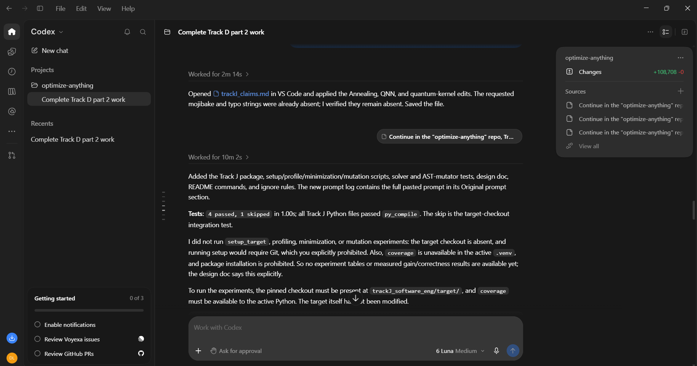

# Prompt log entry
- Date / time: 2026-11-06 01:53:57
- AI tool and model version: codex
- Track: J

## Original prompt

Continue in the "optimize-anything" repo, Track J. Two bugs showed up when running the scripts on Windows. Do only
the following. Do not run git commands and do not install packages. Do not modify anything inside
trackJ_software_eng/target.

0. Logging: run `python tools/new_log.py --track J --tool <the name of the tool you are, in lower case>` and fill the
   "Original prompt" section of the new file with THIS entire prompt. Do not fill other sections.

1. setup_target.py crashes in prepare_work_copy(): shutil.rmtree(WORK) fails with PermissionError [WinError 5] on
   read-only files in work/.git/objects/pack. Fix it in two ways: (a) create the work copy WITHOUT any .git folder
   (shutil.copytree with ignore=shutil.ignore_patterns('.git', '__pycache__', '*.pyc', '.pytest_cache')), and (b) make
   deletion robust on Windows by using shutil.rmtree(path, onexc=handler) (inspect the signature in this Python 3.13) where
   the handler clears the read-only bit with os.chmod and retries. Then make setup_target idempotent and print the commit,
   the source line count of src/sortedcontainers (count non-blank lines of all .py files, and also print the count of
   statements reported by coverage if available) and the number of tests. Run it twice to show the second run works.

2. profile_tests.py collected 366 ids including about 67 doctest items from src/sortedcontainers (the project's own
   pytest configuration adds --doctest-modules), and then failed with "pytest did not report all per-test durations
   (337 missing)". First inspect the target's pytest configuration (setup.cfg, tox.ini, pytest.ini or pyproject) and print
   the relevant lines. Decide and state which tests are the suite under study: the 299 tests in the tests/ directory
   (the documented suite, 299 passed with a plain `pytest tests`). Change profile_tests.py so that it collects and runs ONLY
   tests under tests/ (pass `tests` as the path and override the configuration with `-o addopts=""` and `-p no:doctest`
   or the equivalent that you verify), expects exactly 299 test ids (stop with a clear error if the number differs and print
   the difference), and handles the duration report robustly: parse `--durations=0` output for setup, call and teardown
   phases, sum them per test, and if a test is missing from the report print which ones and why, instead of crashing
   (tests faster than the duration threshold may be omitted: use `--durations=0 --durations-min=0` and verify the
   option exists in this pytest version).

3. Check that the pytest_contexts plugin or the coverage dynamic contexts still attribute lines and branches to each of the
   299 tests (print the number of tests with at least one covered line, and how many tests cover nothing).

4. Run `python -m trackJ_software_eng.setup_target` twice and `python -m trackJ_software_eng.profile_tests` and
   show me the full output, including the 10 slowest tests, the share of runtime by test file and the files written.
   State plainly anything that failed or looks wrong.

## AI response (relevant excerpt)

The tool changed the Track J scripts as requested (setup_target.py, profile_tests.py, minimize.py, setcover.py, mutator.py and tests, as described in the Original prompt) and reported its results. Several of its scripts failed on Windows or on the real data before working; see failure log row 23.

## Revised prompt (if any)

Yes, follow-up prompts fixed the problems found (Windows deletion, doctest collection, zero-cost tests).

## Resulting code change (commit hash or link)

44fa590 ([AI:Codex] feat(trackJ): add test-suite minimization scripts)

## Verification note (what I ran, what I checked independently)

I ran the scripts myself in my virtual environment: `python -m pytest trackJ_software_eng/tests -q` (5 passed), setup_target (commit 3ac3586, 2,936 non-blank source lines, 299 tests), profile_tests (299 tests, 5.3 s per full run, per-test coverage union 1,356/1,356 lines and 452/452 branches) and minimize. The minimal subsets ran 1.2x to 1.8x faster, but none preserved full coverage when run on the real suite (see results/trackJ_actual_coverage.csv), so the recorded coverage model is not valid for subsets. Mutation testing and the fix by isolated per-test coverage were not done. Limitations: 10 ms test-time quantisation, one machine, 3 repetitions.

## Chat export / screenshot (filename in this folder)

screenshot_003.png
