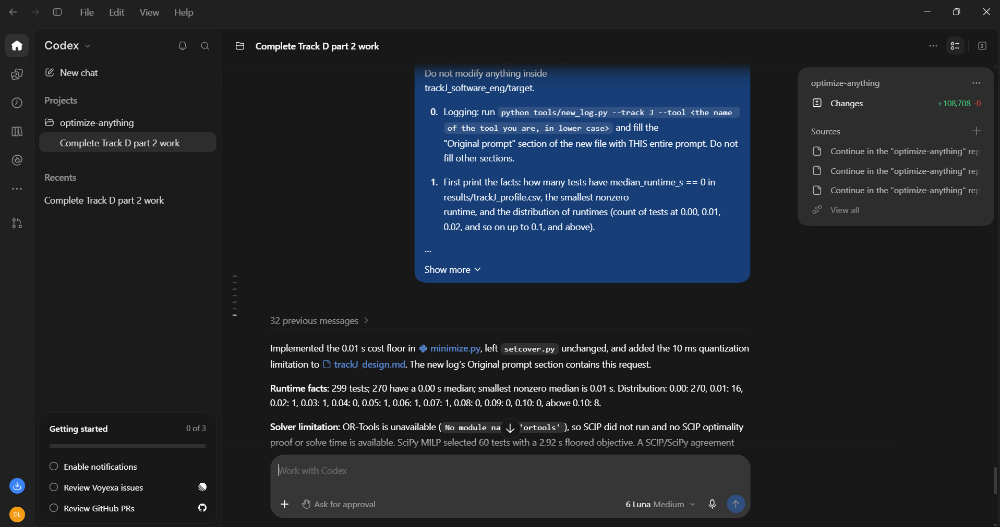

# Prompt log entry
- Date / time: 2026-11-06 08:50:06
- AI tool and model version: codex
- Track: J

## Original prompt

Continue in the "optimize-anything" repo, Track J. `python -m trackJ_software_eng.minimize` fails with
"ValueError: one positive finite cost is required per set" raised in setcover.greedy_cover, because some tests have a
measured median runtime of 0.00 s in results/trackJ_profile.csv (pytest reports durations rounded to 10 ms).
Do only the following. Do not run git commands and do not install packages. Do not modify anything inside
trackJ_software_eng/target.

0. Logging: run `python tools/new_log.py --track J --tool <the name of the tool you are, in lower case>` and fill the
   "Original prompt" section of the new file with THIS entire prompt. Do not fill other sections.

1. First print the facts: how many tests have median_runtime_s == 0 in results/trackJ_profile.csv, the smallest nonzero
   runtime, and the distribution of runtimes (count of tests at 0.00, 0.01, 0.02, and so on up to 0.1, and above).

2. Do not change setcover.py's validation. Define the cost in minimize.py as cost_t = max(median_runtime_s, 0.01), i.e. a floor
   equal to pytest's 10 ms reporting resolution, as a named constant COST_FLOOR_S = 0.01 with a comment explaining that a
   zero cost would make every zero-cost test free to add and would make the greedy ratio undefined. Also record in
   results/trackJ_minimization.csv (and in the printed summary) the TWO totals for each selected subset: the sum of the
   floored costs (the optimised objective) and the sum of the raw median runtimes. State in docs/trackJ_design.md under
   Limitations that individual test runtimes are quantised at 10 ms so the objective is approximate.

3. Because the true runtime of a subset also includes pytest start-up and collection overhead (about 1.3 s here), add a
   fixed-cost note: report the measured wall time of the full suite and of each subset (3 repetitions, with and without
   coverage) as already specified, and state in the output that the optimised objective is the sum of per-test costs
   and not the wall time, and report how well the two agree for the full suite and for the subsets.

4. Run `python -m trackJ_software_eng.minimize` and show me the full output: the facts from item 1, every solver's result
   (tests, total floored cost, total raw runtime, coverage of lines and branches), whether the ILP proved optimality and its
   solve time, whether the SciPy cross-check agrees, the baselines, the results of actually running each covering subset on the
   real suite (pass count, measured coverage against the full suite, and wall times with spread), and the files written.
   State plainly anything that failed, any subset that did not keep full coverage, and any speedup within the timing spread.

## AI response (relevant excerpt)

The tool changed the Track J scripts as requested (setup_target.py, profile_tests.py, minimize.py, setcover.py, mutator.py and tests, as described in the Original prompt) and reported its results. Several of its scripts failed on Windows or on the real data before working; see failure log row 23.

## Revised prompt (if any)

Yes, follow-up prompts fixed the problems found (Windows deletion, doctest collection, zero-cost tests).

## Resulting code change (commit hash or link)

44fa590 ([AI:Codex] feat(trackJ): add test-suite minimization scripts)

## Verification note (what I ran, what I checked independently)

I ran the scripts myself in my virtual environment: `python -m pytest trackJ_software_eng/tests -q` (5 passed), setup_target (commit 3ac3586, 2,936 non-blank source lines, 299 tests), profile_tests (299 tests, 5.3 s per full run, per-test coverage union 1,356/1,356 lines and 452/452 branches) and minimize. The minimal subsets ran 1.2x to 1.8x faster, but none preserved full coverage when run on the real suite (see results/trackJ_actual_coverage.csv), so the recorded coverage model is not valid for subsets. Mutation testing and the fix by isolated per-test coverage were not done. Limitations: 10 ms test-time quantisation, one machine, 3 repetitions.

## Chat export / screenshot (filename in this folder)

screenshot_005.png